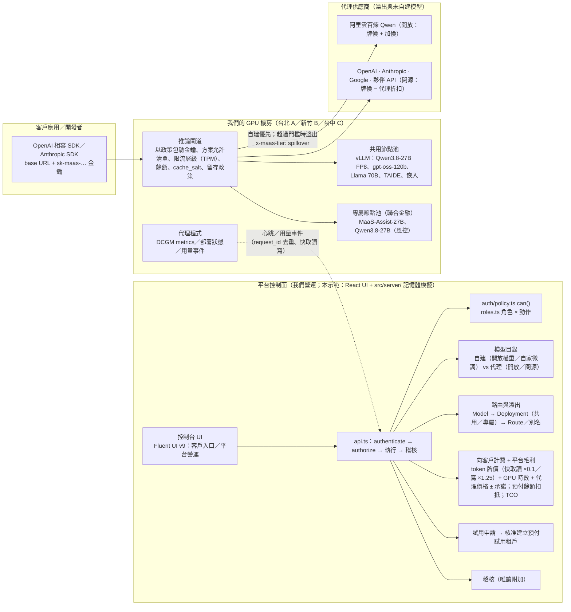

# MaaS 控制台（示範）— 「One API」token 事業的 Model-as-a-Service 主控台

> **免責聲明**：本專案是一個**自訂的示範應用程式**，用於展示一個 GMI Cloud／Inferel 式「賣 tokens」的 MaaS 事業的管理主控台設計——客戶用一把金鑰、一個 OpenAI 相容 API 呼叫**部署在我們自有 GPU 上的開放模型**與**我們代理的閉源／夥伴模型**，我們依 token、GPU 時數與代理價格向客戶收費。它**借用 Azure RBAC 的概念**（主體 + 角色 + 範圍 = 角色指派、範圍繼承、職責分離）與 **Microsoft Fluent 2 設計語言**，但**並非官方 Azure Portal**，**不管理任何真實 Azure 資源**，也與 Microsoft、GMI Cloud、Inferel、阿里雲或任何模型供應商無關。所有客戶、使用者、機房、GPU 指標、API 金鑰、價格、成本、餘額與用量均為**虛構示範資料**；此處的角色為**應用程式角色**，而非 Azure 內建角色。未使用任何 Microsoft／Azure 標誌。

## 產品：One API，所有主流模型，永續的價格

我們（平台供應商）在台北（8 × H100）、新竹（16 × H200）、台中（8 × L40S）擁有自己的 GPU 機房，把**開放權重**（Qwen3.8-27B、Qwen3-Embedding-8B、Qwen3-Coder-30B-A3B、gpt-oss-120b、Llama 3.3 70B、Llama-3.1-TAIDE-LX-8B-Chat、EmbeddingGemma）與**自家微調**模型（虛構的 MaaS-Assist-27B）部署在這些 GPU 上；GPT、Claude、Gemini、阿里雲百煉 Qwen 與圖像／影片／語音模型由我們**代理**。客戶只需要一把 `sk-maas-` 金鑰與一個 base URL（`https://api.maas.example/v1`，另有 Anthropic Messages 相容的 `/v1/messages`）。

商業模型（全部為示意數字，可在「定價與帳務 → 定價參數」調整）：

- **自建 token 牌價**（共用部署）：例如 Qwen3.8-27B US$0.20／0.60 每百萬 tokens；**快取讀取 = 輸入牌價 × 0.1、快取寫入 = 輸入牌價 × 1.25**（Inferel 式）。
- **專屬端點**（dedicated）：保留 GPU 節點池，按 GPU 時數 × 牌價（H100 US$3.9、H200 US$4.9、L40S US$1.4／GPU-hr），部署上的 tokens 不另計，吞吐承諾寫入合約。
- **代理模型**：開放模型（百煉 Qwen 等）**供應商牌價 + 15% 加價**；閉源／夥伴模型（OpenAI、Anthropic、Google、Kling／MiniMax）**供應商牌價 × (1 − 10% 代理折扣)**，我們的成本 = 牌價 × (1 − 15% 議價折扣) → 代理毛利來自兩個折扣之差。模型中心卡片顯示「供應商牌價 → 我們的價格」。
- **預付儲值 vs 月結合約**：隨用隨付客戶預付（US$10–10,000 儲值，依對帳單即時扣抵，可用餘額 ≤ 0 時 API 回 `402 INSUFFICIENT_CREDITS`，可設自動儲值）；承諾用量／專屬客戶月結（TWD 統一發票），單一帳單。
- **限流層級（GMI 式）**：依累計消費自動升級——Tier 0 1M TPM（免費／試用）→ Tier 1 3M（≥ US$50）→ Tier 2 50M（≥ US$500）→ Tier 3 100M（≥ US$1,000）→ Tier 4 300M（月結合約）。
- **SLA**：共用 99.9%、專屬 99.9% + 吞吐承諾；月可用性 < 99.9／99.0／95.0% 分別抵扣 10／25／100%。
- **零留存**：每個租戶（可覆寫到專案）選 `zero`（只留計量事件）或 `30d`；回應標頭 `x-maas-retention`；公部門強制零留存。
- **問卷審核的試用**：客戶在模型中心填「申請測試」問卷 → 平台審核 → 核准即建立**預付試用租戶**（免費額度 US$20 入帳、Tier 0、僅自建、3 個工作天）→ 儲值即轉付費（總覽的試用漏斗）。

路由面保留原有規則：**自建優先、雲端溢出**（每副本等待佇列與 KV cache 使用率同時超過門檻、且租戶已簽署目標區域的跨境同意時溢出，200 + `x-maas-tier: spillover`）、**僅自建**（敏感／公部門／專屬：容量耗盡回 `429 local_capacity_exhausted` + `Retry-After`）、**公部門**（伺服器強制僅自建、排除中國來源模型、零留存）。

示範一個企業級 MaaS 控制面應具備的資訊架構、RBAC 模型與安全邊界：

- **伺服器端授權**：UI 只能透過 `src/server/api.ts` 存取資料；每個 API 都在「伺服器端」（此處為記憶體模擬）做身分驗證與授權，並寫入稽核。UI 隱藏／停用按鈕只是可用性考量，**不是**安全邊界。
- **集中式政策評估器**：`can(principal, action, scope): Decision` 以直接 + 繼承指派計算有效權限，預設拒絕，回傳允許／拒絕的原因與來源指派。
- **職責分離**：特權角色（平台擁有者、客戶管理員）的指派需由**不同主體**核准；禁止自我提權與跨租戶授權。平台層資源（機房、定價與帳務、試用審核、路由）只屬於我們的角色：客戶連導覽群組都看不到，直接呼叫 API 回 403。
- **稽核**：每一筆異動（含儲值、留存切換、定價參數）與每一次被拒絕的嘗試都會留下 actor、principal、action、scope、decision、requestId 與變更前後值。

## 如何執行

### 快速啟動

1. **確認 Node.js 版本 ≥ 20.19**（開發時使用 v22.15.0）。版本過舊（例如 v14／v16）時 Vite 會直接報 `SyntaxError: Unexpected token '||='`。
   ```bash
   node -v
   # 使用 nvm（Windows：nvm-windows；macOS／Linux：nvm）切換版本
   nvm install 22.15.0
   nvm use 22.15.0
   ```
2. **取得原始碼並安裝相依套件**
   ```bash
   git clone https://github.com/kuomingwu/mass-demo.git
   cd mass-demo
   npm install
   ```
3. **啟動開發伺服器**
   ```bash
   npm run dev
   ```
   瀏覽器開啟 <http://localhost:5173/#/>（若 5173 被占用，Vite 會改用下一個埠號，以終端機顯示為準；要讓區網其他裝置連線可用 `npm run dev -- --host`）。
4. **停止**：在終端機按 `Ctrl + C`。

本示範沒有後端或資料庫，所有資料都在瀏覽器記憶體中模擬，不需設定任何環境變數或 API 金鑰。

### 所有指令

```bash
npm install
npm run dev        # 開發伺服器（HashRouter，預設 http://localhost:5173/#/）
npm run build      # 型別檢查 + 產出 dist/（base: './'，可直接以靜態主機或 file:// 開啟 dist/index.html）
npm run preview    # 預覽 dist/
npm test           # vitest：政策／授權、叢集／部署／計費／租戶、商業模型、模型中心、流程圖、路由煙霧測試、多語言（i18n）品質門
```

第一次開啟會自動播放 **平台導覽**（可隨時「略過」；完成或略過後記錄在 `localStorage` 的 `maas-demo-tour-v1`，不再自動彈出）。之後可從右上角「說明」按鈕或「設定 → 新手指引 → 重新播放」再次開啟。

開啟後，使用右上角「**示範用角色切換**」在 11 個角色間切換：我們的角色（平台擁有者 梁小姐、平台營運 林維運、平台財務 郭財務）與客戶角色（客戶管理員 星耀（月結合約）、客戶專案操作員、檢視者、存取管理員、稽核員、客戶財務 聯合金融、公部門客戶管理員（預付、零留存）、試用客戶管理員 ACME（免費額度 US$20、Tier 0））。切換後我們的角色落在「總覽」、客戶落在「模型中心」；客戶角色的標頭顯示「餘額 US$…」（預付）或「月結 · Tier 4」。「設定」頁有「模擬錯誤」「模擬自建容量耗盡」「模擬叢集中斷」開關與「直接呼叫 API」按鈕；定價參數在「定價與帳務」。

## 架構



## 資料夾結構

```
demo/
├── index.html
├── package.json
├── tsconfig.json
├── vite.config.ts            # base: './'，vitest 設定
├── README.md
└── src/
    ├── main.tsx              # ThemeProvider → SessionProvider → NotifyProvider → HashRouter
    ├── app/
    │   ├── AppShell.tsx      # 48px 標頭（客戶餘額）、240px 可收合導覽（客戶入口／平台營運／帳戶與團隊／操作指引）、角色切換落地頁、頁尾免責聲明
    │   ├── routes.tsx        # HashRouter 路由表（/ 對客戶導向 /hub）
    │   ├── SessionContext.tsx# 示範用角色切換、租戶選擇、canUi、模擬開關
    │   └── __tests__/smoke.test.tsx
    ├── auth/
    │   ├── types.ts          # Action（含 billing.topup、trial.review…）、RoleId（含 finance）
    │   ├── scope.ts          # 範圍路徑工具（分段式比對；/clusters/{c} 為平台層）
    │   ├── roles.ts          # 角色定義、角色 × 動作矩陣、供應商角色（VENDOR_ROLES）、高風險組合警示
    │   ├── policy.ts         # can() 集中式政策評估器、委派範圍、自我提權等級
    │   └── __tests__/policy.test.ts
    ├── server/
    │   ├── api.ts            # MockServer：叢集／部署／路由溢出／租戶（計費模式、餘額、留存）／金鑰／Playground（402、x-maas-retention／x-maas-balance）／模型中心／試用申請／帳戶（getTenantAccount、topUpCredits、updateTenantRetention）／對帳單／營收毛利／單價／定價參數／IAM／稽核
    │   ├── seed.ts           # 租戶（方案、計費模式、餘額、留存、層級政策、允許模型、承諾、跨境同意）/ 專案 / 使用者 / 金鑰 / 指派 / 角色切換清單（含試用租戶 ACME）
    │   ├── audit.ts          # 稽核儲存與 requestId
    │   ├── usage.ts          # 用量資料產生器（層級 local／spillover／cloud、快取讀取／寫入 tokens、GPU-hr）
    │   └── __tests__/        # connect、clusters、hub、commercial（儲值／402／層級／快取讀寫／代理毛利／留存／漏斗）
    ├── data/
    │   ├── commercial.ts     # 商業模型常數：計費模式、留存、儲值範圍、快取倍率、代理價格政策（proxyKindOf／customerPriceFactor／vendorCostFactor）、限流層級、SLA
    │   ├── models.ts         # 模型目錄（自建牌價、代理模型的供應商牌價、origin、licenseType、deployable；模型中心欄位由 withHubFields() 推導）
    │   ├── providers.ts      # 代理供應商端點、自建推論層摘要、路由（placementPolicy、spillover）
    │   ├── clusters.ts       # 我們的叢集／節點池／節點／部署、GPU 規格與牌價／TCO、VRAM 適配、內部成本與毛利公式
    │   ├── guides.ts         # 12 則操作指引（客戶旅程／平台營運；互動步驟以 data-tour 錨點驅動）
    │   └── guideFlows.ts     # 每則指引的情境流程圖（SVG 泳道圖）
    ├── components/           # PageHeader、States、StatusBadge、TopUpDialog（儲值）、OnboardingTour（導覽引擎）、ScenarioFlow、ConfirmDialog、CodeBlock、charts/…
    ├── pages/
    │   ├── hub/              # HubPage（模型中心：hero／來源／Model Hub 卡片（供應商牌價 → 我們的價格）／SLA／公開價格 API 範例／整合／FAQ／GPU 時租）、ModelHubGrid、ModelApiDialog、TrialRequestPage、hubContent.ts
    │   ├── PlanPage.tsx      # 試用與方案：計費模式、餘額與扣抵、儲值、試用狀態、限流層級表、留存、SLA
    │   ├── TrialsPage.tsx    # 試用申請佇列與審核（平台營運）；tenants/TrialRequestsTab
    │   ├── PricingPage.tsx   # 定價與帳務：平台營收與毛利／單價與毛利（每部署）／代理模型定價／定價參數
    │   ├── clusters/         # ClustersPage、ClusterDetailPage、RegisterClusterDrawer
    │   ├── deployments/      # DeploymentsPage、CreateDeploymentDrawer、DeploymentsTable、ScaleDeploymentDialog
    │   ├── tenants/          # CreateTenantDrawer（客戶上線）、TrialRequestsTab
    │   ├── providers/        # ConnectProviderDrawer
    │   ├── iam/              # 五個分頁與多步驗指派 Drawer
    │   └── …                 # Overview（平台營運 KPI）、Models、Providers、Routing、Tenants、TenantDetail（餘額／層級／留存卡）、Keys、Playground、Usage（用量／對帳單）、Audit、Guides、Settings
    ├── hooks/useApi.ts
    └── theme/
```

## 物件模型

```
Cluster（我們的機房；/clusters/{c}）  狀態機：等待加入 → 已連線 / 中斷 / 服務異常 / 缺少前置條件
├── NodePool（共用 shared｜專屬 dedicated → tenantId）
│   └── Node（DCGM：GPU 型號×數、已分配/可用、記憶體、SM 使用率、閒置、MIG）
└── Deployment（Model × Cluster × sharing（共用／專屬 + 租戶）× 引擎 × 量化 × 副本 × 自動擴縮 × rollout；由平台營運建立）
      建立中 → 就緒 / 縮至零 / 錯誤

Tenant（客戶：plan 隨用隨付/承諾用量/專屬、billingMode prepaid/postpaid、credits{balanceUsd, autoReload?, trial?}、retention zero/30d、dataClass、allowedTiers、allowedModels、excludeOrigins、commitment、quotas、成本中心、帳務聯絡人、crossBorderConsent）
└── Project（retention 覆寫）→ API Key（sk-maas-、只存雜湊、部分提示、層級限制、到期 ≤ 90 天／臨時 ≤ 1 小時、預算+週期、tpm/rpm/併發、自動輪替）

Model（目錄）：自建（providerId vllm；priceInput/Output = 我們的牌價）
             vs 代理開放（bailian：供應商牌價 → +加價）vs 代理閉源／夥伴（openai/anthropic/google/partner：供應商牌價 → −代理折扣；成本 −議價折扣）
Route／別名（對外 model 名稱 → 目標權重、備援鏈、部署政策、spillover{enabled, threshold, target}）
TrialRequest（問卷 → pending/approved/rejected → tenantId）；TopUpRecord（topup/trial-grant/auto-reload）
```

## 範圍階層與主體

```
/                                   平台（我們：叢集、部署、租戶建立、試用審核、定價與帳務、代理供應商、路由）
├── /clusters/{clusterId}           我們的 GPU 叢集（平台層資源；客戶主體一律拒絕）
└── /tenants/{tenantId}             客戶租戶（星耀 t-star、聯合金融 t-union、示範市政府資訊局 t-gov、ACME 試用 t-acme-trial）
    └── /tenants/{t}/projects/{p}   專案
        ├── …/keys/{k}              API 金鑰（資源）
        └── …/routes/{r}            模型路由（資源）
```

- 主體：使用者、群組、服務主體（每把 API 金鑰對應一個服務主體）。群組成員資格由可信種子（模擬 IdP）解析，不信任客戶端。
- 範圍比對採**分段式**：`/tenants/t-star` 是 `/tenants/t-star/projects/p-cs-bot` 的祖先，但不是 `/tenants/t-star2` 的祖先。
- **租戶邊界獨立驗證**：屬於某客戶的主體，無論客戶端傳入什麼 scope，都不能存取其他客戶的範圍（含帳戶、儲值、對帳單），也不能被授予平台或叢集範圍。
- **公部門客戶**（t-gov）由伺服器強制「僅自建」、排除中國來源模型（含以 Qwen 為基底微調的 MaaS-Assist-27B）、零留存（不可改為 30 天）：依據《各機關對危害國家資通安全產品限制使用原則》（2019 訂、2022-11 修）、行政院 2025-02 院會決議、數發部／陸委會 2025-11-17 說明（統一字串 `PUBLIC_SECTOR_LEGAL_BASIS`）。
- **跨境資料傳輸同意**（`Tenant.crossBorderConsent`）：溢出或代理只會把請求送到客戶已簽署同意的區域；目標區域不在同意清單 → 視同「僅自建」（`429 local_capacity_exhausted`，`x-maas-deny-reason: no_cross_border_consent`）。
- **API 金鑰服務主體最小權限**：每把金鑰的服務主體只拿 `inference-caller`（`playground.invoke` + `model.read` + `project.read`）。

## 角色 × 動作矩陣

來源：`src/auth/roles.ts`（IAM →「角色」分頁亦會即時渲染）。✓ = 允許。我們的角色：平台擁有者、平台營運、平台財務（只能指派於平台範圍）；其餘為客戶角色。

| 動作 | 平台擁有者 | 平台營運 | 平台財務 | 客戶管理員 | 存取管理員 | 專案操作員 | 稽核員 | 客戶財務 | 檢視者 | 推論呼叫者（金鑰 SP） |
|---|:-:|:-:|:-:|:-:|:-:|:-:|:-:|:-:|:-:|:-:|
| model.read | ✓ | ✓ | ✓ | ✓ | | ✓ | ✓ | | ✓ | ✓ |
| model.route.update（平台層） | ✓ | | | | | | | | | |
| provider.read | ✓ | ✓ | ✓ | ✓ | | ✓ | ✓ | | ✓ | |
| provider.configure | ✓ | | | | | | | | | |
| cluster.read | ✓ | ✓ | ✓ | | | | | | | |
| cluster.register | ✓ | ✓ | | | | | | | | |
| cluster.operate | ✓ | ✓ | | | | | | | | |
| deployment.read | ✓ | ✓ | ✓ | ✓ | | ✓ | ✓ | | ✓ | |
| deployment.manage | ✓ | ✓ | | | | | | | | |
| key.read / create / revoke | ✓ | | | ✓ | | ✓ | read | | read | |
| playground.invoke | ✓ | | | ✓ | | ✓ | | | | ✓ |
| usage.read | ✓ | ✓ | ✓ | ✓ | | ✓ | ✓ | ✓ | ✓ | |
| billing.read | ✓ | | ✓ | ✓ | | ✓ | ✓ | ✓ | ✓ | |
| billing.export | ✓ | | ✓ | ✓ | | | | ✓ | | |
| billing.topup（儲值） | ✓ | | ✓ | ✓ | | | | ✓ | | |
| billing.configure | ✓ | | ✓ | | | | | | | |
| tenant.read | ✓ | ✓ | ✓ | ✓ | ✓ | ✓ | ✓ | ✓ | ✓ | |
| tenant.create | ✓ | | | | | | | | | |
| tenant.update（含留存政策） | ✓ | | | ✓ | | | | | | |
| trial.review（平台層） | ✓ | | ✓ | | | | | | | |
| project.read / create / update / delete | ✓ | | read | ✓ | read | read+update | read | read | read | read |
| iam.read / assign | ✓ | | | ✓ | ✓ | | read | | read | |
| iam.approve | ✓ | | | ✓（租戶範圍，不可核准自己申請） | | | | | | |
| audit.read / export | ✓ | | | ✓ | read | | ✓ | | | |

補充規則（在 `api.ts` 強制執行）：

- **特權角色**（平台擁有者、客戶管理員）的指派：平台層主體在具 `iam.approve` 的範圍直接生效；客戶管理員自己提出的特權指派仍建立 `pending`，需由**另一位**具 `iam.approve` 的主體核准；核准者**不得**是申請者或受益主體；平台範圍的待核准只有平台擁有者能核准。
- **委派範圍**：指派者只能在自己持有 `iam.assign` 的範圍（及其子範圍）內指派。**自我提權**：不可為自己（或所屬群組）指派高於目前等級的角色。**跨租戶**：主體所屬租戶必須與目標範圍的租戶一致；我們的角色只能指派於平台範圍。
- **叢集為平台層資源**：`listClusters`／`getCluster`／`registerCluster` 對客戶角色回 403；`listDeployments` 對客戶過濾為「共用且方案允許的模型」+「專屬於自己」的部署；專屬部署給排除該模型來源地的租戶回 `400 MODEL_NOT_ALLOWED`。註冊叢集要求 Kubernetes ≥ 1.32，一次性加入 token 以 `--from-file` 建立 Secret。
- **專屬節點池不自動借用共用池**：售滿回 `409 DEDICATED_POOL_EXHAUSTED`，除非明確 `allowSharedFallback: true`（寫入稽核）。**VRAM 適配含 KV cache**（27B BF16／131k／128 seqs 放不下 1 × H100；gpt-oss-120b 只能 MXFP4 → `QUANT_NOT_SUPPORTED`）。
- **方案允許清單**：金鑰與 Playground 只能使用租戶 `allowedModels` 內且來源地未被排除的模型；僅自建金鑰可選「自建優先」別名，容量耗盡回 429 不溢出。金鑰到期 ≤ 90 天以日曆日比較。
- **路由是平台層資源**：`model.route.update` 只有平台擁有者；自建優先的主要目標只能是自建，雲端只能經由 `spillover`；`prefer-intl`／`intl-only` 不可含 `cn-beijing`；溢出門檻為每副本等待佇列且 KV cache 使用率。回應標頭含實際服務的 `x-maas-model`。
- **預付餘額**：`invokePlayground` 在授權與租戶檢查後、路由之前檢查可用餘額（總帳 − 本月至今對帳單）；≤ 0 回 `402 INSUFFICIENT_CREDITS`（稽核 deny），成功回應帶 `x-maas-balance`（月結為 `postpaid`）。`topUpCredits` 需租戶範圍 `billing.topup`、只接受預付租戶（月結 `409 NOT_PREPAID`）、US$10–10,000，稽核含前後餘額。
- **留存政策**：`updateTenantRetention` 需 `tenant.update`；公部門不可改為 `30d`（400）；所有 Playground 回應（含 402／429）帶 `x-maas-retention`（專案覆寫優先）。
- **專屬涵蓋 tokens 是每個部署的規則**：由專屬部署服務的 tokens 不另計；同租戶走共用部署的 tokens 按牌價。新建的專屬部署不會回溯涵蓋共用部署服務過的 tokens。
- **不揭露其他租戶的主體**；**繼承的指派**只能在其來源範圍刪除（子範圍 `409 INHERITED_ASSIGNMENT`）。

## 導覽與頁面

左側導覽分三組（＋底部操作指引）：

- **客戶入口**（所有角色）：模型中心 `/hub` → Playground `/playground` → API 金鑰 `/keys` → 用量與帳單 `/usage` → 試用與方案 `/plan`
- **平台營運**（只有我們的角色看得到；客戶直接開 URL 得到伺服器 403）：總覽 `/`、試用申請 `/trials`、租戶與專案 `/tenants`、模型與部署 `/models`／`/deployments`、推論叢集 `/clusters`、雲端與夥伴供應商 `/providers`、路由與溢出 `/routing`、定價與帳務 `/pricing`、存取控制 `/iam`、稽核紀錄 `/audit`、設定 `/settings`
- **帳戶與團隊**（客戶角色）：存取控制、稽核紀錄、設定
- **操作指引** `/guides`（所有角色）

切換角色後：我們 → `/`；客戶 → `/hub`（客戶開 `/` 一律導向模型中心）。舊路由 `/usage?tab=unit|revenue` → `/pricing?tab=…`，`/tenants?tab=trials` → `/trials`。

| 路由 | 頁面 | 重點 |
|---|---|---|
| `#/hub`、`#/hub?tab=integrations`、`#/hub?tab=faq` | **模型中心** | 客戶入口：hero（一個 API，所有主流模型，永續的價格；立即開始 → API 金鑰、查看文件、申請試用）、模型來源 chips、**Model Hub** 卡片（模態分頁、供應來源 自建 GPU／代理模型、來源地、授權、搜尋、價格排序；每卡：徽章、上下文或計價單位、**我們的價格**——自建附市場參考價，代理顯示「供應商牌價 → 我們的價格（+15% 加價／−10% 代理折扣）」、「試用」→ Playground 預選、「API」→ curl／Python／Node）、不只是 API 路由器、相同模型更好的經濟性（含限流層級）、從 Demo 到正式上線（SLA、零留存、專屬端點、問卷審核的試用）、**SLA 與服務抵扣**；整合分頁：連線資訊、**`/v1/messages` 範例**、**公開價格 API `GET /v1/models` 範例回應**（含 `vendor_list_pricing`、快取倍率、限流層級表）、Claude Code／Cursor／Dify／LiteLLM／OpenClaw；FAQ（含付費方式）、GPU 時租。目錄由伺服器 `listHubModels` 依租戶政策過濾 |
| `#/hub/trial` | 申請測試 | Inferel 式 5 段式公開問卷（不需登入）→ `submitTrialRequest`（驗證、速率限制、稽核 actor=public、狀態待審）→「已收到申請」→ 返回模型中心 |
| `#/playground`、`#/playground?model=…` | Playground | `?model=` 預選；專案／模型依權限過濾、模擬串流、向客戶收費估算（自建 token 牌價／專屬含於 GPU 時數／代理我們的價格）、**回應標頭**（`x-maas-tier`／`x-maas-model`／`x-maas-region`／`x-maas-deployment`／`x-maas-sharing`／**`x-maas-retention`**／**`x-maas-balance`**／`x-maas-spillover-from`／Retry-After／`x-maas-deny-reason`）、**402 INSUFFICIENT_CREDITS 含儲值連結**、等效 `curl -i` |
| `#/keys` | API 金鑰 | `sk-maas-` 前綴、只存雜湊、層級限制、模型白名單、到期 ≤ 90 天、自動輪替 |
| `#/usage`、`#/usage?tab=statement` | 用量與帳單 | 用量分頁（層級／供應商／模型／狀態圖表、明細含快取讀取／寫入、CSV 匯出需 `billing.export`）、**對帳單**（計費模式與留存徽章、預付租戶的**餘額扣抵卡**、(a) 自建 token 費含快取讀取／寫入分列、(b) 專屬 GPU 時數、(c) 代理模型明細「供應商牌價 → 我們的價格」分開放／閉源、(d) 承諾調整、各專案拆分、預算告警、TWD 換算） |
| `#/plan` | **試用與方案** | 方案 · 計費模式、可用餘額（總帳 − 本月扣抵）與**儲值**對話框（US$10–10,000）、試用狀態（免費額度、到期）、低餘額警示、**限流層級**（目前層、距下一層、GMI 式層級表）、留存政策、**SLA 與服務抵扣**；我們的角色可切換檢視任一租戶 |
| `#/` | 總覽（平台營運） | KPI：**本週 tokens（自建／代理）**、**本月營收**（自建 token／代理／專屬 GPU）、毛利率、自建 GPU 利用率、**活躍租戶 · 試用漏斗**（申請 → 核准 → 付費轉換）、溢出比例、**SLA 達成**；本月營收拆分卡（＋儲值預收、毛利）、自建 GPU vs 代理模型、試用漏斗卡、機房健康、代理供應商健康、24h 流量、最近稽核。客戶開此路由導向 `/hub` |
| `#/trials` | **試用申請** | 佇列（待審／已核准／已拒絕；種子：ACME 已核准 → `t-acme-trial`、示範市立圖書館待審）、問卷詳情抽屜、「核准並建立試用租戶」（預付、免費額度 US$20 入帳、Tier 0、僅自建、公部門 → 排除 cn + 零留存、+3 工作天、給客戶的下一步）、拒絕（需原因）；需 `trial.review`（客戶與平台營運 403） |
| `#/tenants`、`#/tenants/:id` | 租戶與專案 | 清單含計費模式與餘額；詳情：政策、成本中心、資料分級、跨境同意、方案 · 計費模式、**預付餘額卡（儲值）**、**限流層級卡**、**資料留存卡（零留存切換，tenant.update，公部門鎖定）**、允許模型、配額、預算、服務此租戶的部署、專案；「新增租戶」抽屜 |
| `#/models`、`#/deployments` | 模型與部署 | 目錄分「自建」（我們的牌價）與「代理」（供應商牌價）；部署清單含共用／專屬；建立部署抽屜（VRAM 含 KV cache、節點池、量化、專屬租戶、允許借用共用池） |
| `#/clusters`、`#/clusters/:id` | 推論叢集 | 三座機房；「註冊叢集」四步驟抽屜；節點／部署／節點池／事件分頁。客戶角色看不到 |
| `#/providers` | 雲端與夥伴供應商 | 自建推論層摘要 + 阿里雲百煉（開放：牌價 + 加價）、OpenAI、Anthropic、Google、夥伴 API（閉源：牌價 − 代理折扣）；「連接供應商」精靈 |
| `#/routing` | 路由與溢出 | 別名 → 目標權重、備援鏈、部署政策、允許區域、spillover 門檻與目標；回應標頭與錯誤碑文件 |
| `#/pricing?tab=revenue|unit|proxy|settings` | **定價與帳務** | **平台營收與毛利**（營收 = Σ 對帳單、自建 token／代理／專屬／承諾、儲值預收、GPU TCO、代理：供應商牌價 → 我們的成本 → 營收與開放／閉源毛利率、各客戶、GPU 機隊成本、各模型毛利率）、**單價與毛利（每部署）**（內部成本、100% 利用率下限、達 40% 毛利所需利用率 u*、市場參考價、可比代理價）、**代理模型定價**（每個代理模型：供應商牌價 → 我們的價格 → 我們的成本 → 單位毛利率）、**定價參數**（token 牌價、快取讀取／寫入倍率、GPU 牌價與 TCO、代理加價 %、代理折扣 %、議價折扣 %、匯率；需 `billing.configure`）。只給平台範圍 `billing.read`（擁有者／財務） |
| `#/iam` | 存取控制 | 範圍選擇器 + 麵包屑；角色指派／角色矩陣／有效存取／待核准請求／稽核；多步驟新增指派 Drawer |
| `#/audit` | 稽核紀錄 | 篩選、展開 before/after（含 `billing.topup`、`tenant.update` 留存、`trial.review`）、匯出需 `audit.export` |
| `#/guides` | 操作指引 | 12 則情境指引分「客戶旅程」／「平台營運」：逐步說明、情境流程圖（SVG 泳道圖）、一鍵啟動互動導覽 |
| `#/settings` | 設定 | 主題、示範開關（模擬錯誤／自建容量耗盡／叢集中斷）、推論閘道說明、新手指引重播、直接呼叫 API 示範、定價參數連結、免責聲明 |
| 其他 | 403 / 404 | 權限不足頁含「向存取管理員申請」連結 |

### 操作指引

客戶旅程：

1. **從模型中心到第一次 API 呼叫（互動操作）**：客戶管理員——模型中心（供應商牌價 → 我們的價格）→ 篩選自建 GPU → 模型卡「API」→ 建立金鑰 → Playground（`?model=` 預選）→ 回應標頭（tier／retention／balance）
2. **建立 API 金鑰並測試（互動操作）**
3. 權限不足（403）與申請存取（客戶看不到「平台營運」群組）

平台營運：

4. **平台導覽**（One API 的兩條路徑：客戶入口 vs 平台營運；總覽 KPI；試用申請 → 部署 → 定價與毛利）
5. **客戶申請測試 → 平台核准建立試用租戶（互動操作）**：模型中心「申請試用」→ 問卷 → `/trials` 核准 → 預付試用租戶
6. **註冊叢集（互動操作）** 7. **部署模型：共用 vs 專屬（互動操作）** 8. **新增租戶：客戶上線（互動操作）**
9. **連接代理供應商：阿里雲百煉（互動操作）** 10. 自建優先與溢出 11. **新增角色指派與核准（互動操作）**
12. 向客戶收費與平台毛利（用量與帳單 → 對帳單 → 匯出 → 定價與帳務：營收／單價／代理定價／定價參數）

## 申請測試流程（Inferel 式）

1. **公開問卷（訪客）**：S1 測試條件（免費額度 US$20、3 個工作天；測試帳號名稱、IP 白名單）→ S2 要測的模型（RPM／TPM／TTFT／快取命中率）→ S3 情境、用途、路由偏好、每月 tokens、併發、在地需求（資料留台、公部門、發票）→ S4 其他需求 → S5 聯絡資訊。
2. **伺服器 `submitTrialRequest`**（不需登入）：驗證、速率限制（同一 Email 最多 3 筆待審、每分鐘 20 筆）、同帳號名稱重複 409、狀態 `pending`、稽核 `trial.submit`（actor=public）。不建立任何租戶或金鑰。
3. **平台審核**（`trial.review`：平台擁有者、平台財務）：`#/trials` 佇列 → 詳情 → **核准並建立試用租戶**（`approveTrialRequest`：plan payg、`billingMode: prepaid`、`credits.balanceUsd = 20`（儲值紀錄 `trial-grant`）、`credits.trial.expiresAt = +3 工作天`、`allowedTiers: local`、公部門 → `excludeOrigins: ['cn']` + `retention: 'zero'`、允許清單 = 申請的模型（不可用者剔除並說明）、成本中心 `TRIAL-<帳號>`）；或拒絕（需原因）。稽核 `trial.review`（before/after）。試用租戶首次 `topUpCredits` 或轉月結即計入總覽的「付費轉換」。

## 計費公式

```
客戶月對帳單
  (a) 自建模型 token 費 = Σ (模型 × 服務部署) [(輸入 − 快取讀取 − 快取寫入) × 輸入牌價 + 快取讀取 × 輸入牌價 × 0.1 + 快取寫入 × 輸入牌價 × 1.25 + 輸出 × 輸出牌價] ÷ 1e6
       示意牌價：Qwen3.8-27B 0.20/0.60、gpt-oss-120b 0.15/0.60、Llama 3.3 70B 0.25/0.50、MaaS-Assist-27B 0.40/1.20、TAIDE 0.15/0.30、Qwen3-Embedding 0.05、EmbeddingGemma 0.01（USD／百萬 tokens）
       （由專屬部署服務的用量列 tokens 不計：含於 (b)；同模型走共用部署的列按牌價）
  (b) 專屬端點費 = Σ 專屬部署 ∫期間 [副本(t) × 每副本 GPU] dt × GPU 牌價（H100 US$3.9、H200 US$4.9、L40S US$1.4／GPU-hr）
  (c) 代理模型 = Σ 模型：開放模型（providerId bailian）供應商牌價 × (1 + 15%)；閉源／夥伴（openai／anthropic／google／partner）供應商牌價 × (1 − 10%)
       （溢出到代理模型的用量同一政策；模型可個別覆寫 proxyDiscountPct）
  小計 = (a) + (b) + (c)
  (d) 承諾用量方案（plan = committed）：本期承諾額 = 月承諾額 × 天數 ÷ 當月天數；折扣 = 本期承諾額 × 15%；超額 = max(0, 小計 − 本期承諾額)；不足額補足 = max(0, 本期承諾額 − 小計)
       合計 = 小計 − 折扣 + 不足額補足；其他方案：合計 = 小計
  TWD 備註 = 合計 × 匯率（示意 32.5）

預付儲值（billingMode = prepaid）
  可用餘額 = credits.balanceUsd（儲值入帳總帳）− 本月至今對帳單合計
  可用餘額 ≤ 0 → Playground／API 402 INSUFFICIENT_CREDITS；≤ 低餘額門檻（autoReload.thresholdUsd 或 US$100）→ 警示
  儲值 US$10–10,000（billing.topup；稽核前後餘額）；試用贈送 US$20 以 trial-grant 入帳
  限流層級 = tierForSpend(累計消費（用量涵蓋月份的對帳單合計）, 月結合約)：0→1M、≥50→3M、≥500→50M、≥1,000→100M；月結 → Tier 4 300M TPM

平台營收與毛利（我們）
  營收 = Σ 各租戶對帳單合計（總覽、定價與帳務、Σ 對帳單三處同一數字）
  GPU 成本（TCO）= Σ 機房 GPU 數 × TCO／GPU-hr × 期間內存在小時數（含閒置與服務異常；示意 H100 US$2.0、H200 US$2.4、L40S US$0.6）
  代理供應商成本 = Σ 開放模型供應商牌價 + Σ 閉源模型供應商牌價 × (1 − 15% 議價折扣)
  毛利 = 營收 − GPU TCO − 代理供應商成本；毛利率 = 毛利 ÷ 營收
  代理毛利率：開放 = 15 ÷ 115 ≈ 13.0%；閉源 = (0.9 − 0.85) ÷ 0.9 ≈ 5.6%
  儲值預收 = 本月儲值入帳（預付；消耗後才認列為營收）
  部署內部成本（USD／百萬 tokens）= GPU TCO × 每副本 GPU 數 ÷ (tok/s × 利用率 × 3600) × 1e6
  混合牌價 = 70% 輸入牌價 + 30% 輸出牌價；token 毛利率 = (混合牌價 − 內部成本) ÷ 混合牌價
  達 40% 毛利所需利用率 u* = 100% 利用率成本 ÷ (混合牌價 × 0.6)（> 1 表示以此牌價無法達標）
  專屬部署毛利率 = (GPU 牌價 − TCO) ÷ GPU 牌價

吞吐（單一查表 tokPerSecPerGpu，src/data/clusters.ts）
  每卡 tok/s = GPU 參考值（27B 稠密 FP8：H100 4,000、H200 5,500、L40S 1,100）× (27 ÷ 參數量)^0.8（上限 4×；MoE 以啟用參數計再 × 0.6；嵌入 × min(16, 27 ÷ 參數量) × 3）× 量化係數（BF16 0.7／FP8 1／INT4 1.15）
  每副本 tok/s = 每卡 × 卡數 × 張量平行效率（1 卡 1.0、2 卡 0.9、≥ 4 卡 0.8）
```

所有牌價、倍率、TCO、加價、折扣與匯率在「定價與帳務 → 定價參數」調整（需 `billing.configure`：平台擁有者、平台財務；寫入稽核 before/after）；對帳單、模型中心卡片價格、平台營收與毛利即時重算。

用量種子採**供給側**產生（`src/server/usage.ts`）：每個就緒部署每日 tokens ＝ tok/s × 副本 × 利用率 × 86,400 × 當日係數，再依 `DEPLOYMENT_CONSUMERS` 權重拆到專案；自建列另標示快取讀取（20–40% 輸入）與快取寫入（5–10% 輸入）。示範數字（2026-11-01 ～ 11-08，8 天）：營收 US$17,732（自建 token ≈ US$7,853、代理 ≈ US$2,953、專屬 ≈ US$7,526、承諾調整 −US$600），毛利率 ≈ 21%；本月儲值預收 US$2,020（公部門自動儲值 2,000 + 試用贈送 20）；公部門預付總帳 US$4,000、本月扣抵 ≈ US$1,070、Tier 3；試用 ACME 餘額 US$20、Tier 0；已連線機房加權利用率 57%；溢出約 1.4% 請求。

## 開發者介面（API 形狀）

- Base URL `https://api.maas.example/v1`（示意）：`POST /v1/chat/completions`、`GET /v1/models`（**公開價格 API**：每個模型的我們價格、代理模型的 `vendor_list_pricing`、自建模型的快取倍率、限流層級表），以 `model` 字串（別名）為路由鍵。另有 `/v1/messages`（Anthropic Messages 相容轉接層，Claude Code 用 `ANTHROPIC_BASE_URL=https://api.maas.example`）、`/v1/embeddings`、`/v1/rerank`、`/v1/images/generations`、`/v1/videos`、`/v1/audio/speech`／`/v1/audio/transcriptions`。
- 回應標頭：`x-maas-tier: local|spillover|external`、`x-maas-served-by`、`x-maas-model`、`x-maas-deployment`、`x-maas-region`、`x-maas-sharing`、`x-maas-cluster`、**`x-maas-retention: zero|30d`**、**`x-maas-balance`**（預付可用餘額；月結 `postpaid`）、`x-maas-spillover-from`、`x-maas-spillover-reason`、`x-maas-deny-reason`、`x-maas-route`、`x-maas-request-id`。
- 錯誤碼：**`402 INSUFFICIENT_CREDITS`**（預付餘額用盡）、`429 local_capacity_exhausted`（附 `Retry-After: 15`）、`429 rate_limit_error/quota_error`、`503 DEPLOYMENT_SCALING_UP`、`503 NO_CAPACITY`、`400 TIER_NOT_ALLOWED`、`400 MODEL_NOT_ALLOWED`、`400 INSUFFICIENT_VRAM`、`400 QUANT_NOT_SUPPORTED`、`400 INSUFFICIENT_GPUS`、`409 DEDICATED_POOL_EXHAUSTED`、`409 CLUSTER_NOT_CONNECTED`、`409 DEPLOYMENT_IN_USE`、`409 NOT_PREPAID`（月結租戶儲值）、`400 CROSS_BORDER_CONSENT_REQUIRED`、`400 KEY_EXPIRY_REQUIRED/KEY_EXPIRY_TOO_LONG/EPHEMERAL_TOO_LONG`。

## 安全邊界說明

1. **伺服器端強制執行**：`MockServer` 的每個 API 都先 `authenticate(session)` 再 `authorize(principal, action, scope)`，集合類 API 會把結果**過濾為授權列**；平台層 API（叢集、定價與帳務、試用審核、路由）對客戶角色回 `403`；未登入 `401`、找不到 `404`、狀態衝突 `409`、餘額不足 `402`。
2. **預設拒絕**：找不到任何授予該動作的有效指派即拒絕；`Decision.reason` 會說明原因。
3. **稽核**：所有異動與拒絕皆附加至唯讀稽核儲存，含 `requestId`。
4. **UI 不是邊界**：客戶角色看不到「平台營運」導覽群組，但直接輸入 `/pricing`、`/trials`、`/clusters` 仍由伺服器回 403；設定頁的「直接呼叫 API」按鈕繞過所有 UI 判斷嘗試自我提權，除平台擁有者外均得到 403 並留下稽核。
5. **成功訊息只在伺服器回應後顯示**：不做樂觀更新。
6. **資料面邊界**：金鑰驗證、方案允許清單、限流層級、餘額與留存政策在我們機房的推論閘道以簽章政策包執行；用量事件（request_id 去重、快取讀取／寫入、共用／專屬）回報控制面計費（示範以控制面模擬）。

## 多語言（i18n）

- **語系**：繁體中文 `zh-TW`（預設、來源語言）、English `en`、日本語 `ja`。自製輕量 i18n（`src/i18n/`，無第三方套件）：平面字典 + `{name}` 插補 + `Intl.PluralRules` 複數 + `Intl` 數字／日期格式（US$ 金額各語系相同；新台幣 zh-TW／ja 為 `NT$`、en 為 `TWD`）。
- **切換**：頁首的地球圖示按鈕（`data-tour="lang-switch"`，選單以各語言原生名稱顯示）。選擇寫入 `localStorage` 的 `maas-demo-lang`，立即重繪並更新 `<html lang>`（`zh-Hant-TW`／`en`／`ja`）；首次造訪（尚未選過）一律顯示**英文**（`INITIAL_LOCALE = 'en'`，見 `src/i18n/core.ts`；`detectLocale` 保留可改回依瀏覽器偵測；測試環境固定繁中）。繁中仍是來源語言與最終備援。
- **備援**：ja → en → zh-TW、en → zh-TW；三層都缺鍵時回傳鍵本身並在開發模式 `console.warn('[i18n] missing key: …')`，絕不渲染空白。zh-TW 的輸出與多語化前逐字相同。
- **鍵與字典**：`src/i18n/dict/<locale>/<area>.ts`（12 個區域：common、shell、overview、data、server、guides、flows、hub、billing、ops、customer、admin），每語系 3,439 個鍵，三語系鍵集合必須完全相同。鍵命名 `<area>.<page>.<element>`；枚舉 `data.<MAP>.<value>`（`tl()`）；資料驅動文字 `tf(t, key, zhFallback)`；伺服器訊息帶 `messageKey`／`params`，UI 以 `apiMessage(t, err)` 顯示；種子租戶／使用者名稱用 `tenantLabel()`／`principalLabel()`。完整慣例與翻譯風格見 [`src/i18n/README.md`](src/i18n/README.md)。示範專有名詞（租戶、專案、金鑰、人名、機房）列在 `src/i18n/allowlist.json`，可保留中文。
- **測試門檻**：`src/i18n/__tests__/i18n.test.ts`（鍵集合一致、值非空、en 字典無 CJK、ja 字典無繁體專用字、原始碼掃描無殘留中文〔排除註解與 allowlist〕、en／ja 掛載導覽＝字典值且無 zh-TW 外漏、語言切換即時重繪）與 `routes.i18n.test.tsx`（3 語系 × owner／tenant-admin／gov-admin × 55 條路由：無未解析鍵、無 missing-key 警告、en 無 CJK、ja 無逐字 zh-TW 文案與繁體專用字）。
- **新增鍵**：在三個語系的同一區域檔加入同一個鍵（zh-TW 先寫），元件用 `t('area.page.element')`；跑 `npm test` 確認鍵集合與外漏檢查通過。
- **新增語系**（例如 `ko`）：在 `types.ts` 的 `Locale`／`LOCALES`／`LOCALE_NATIVE_NAMES`／`LOCALE_TAGS`／`FALLBACK_CHAIN`／`detectLocale` 加入；複製 `dict/en/` 為 `dict/ko/` 並翻譯；新增 `src/i18n/ko.ts` 入口並在 `core.ts` 的 `DICTS` 註冊；`core.ts` 的 `applyHtmlLang` 與 `format.ts` 視需要調整；把新語系加進 `i18n.test.ts`（鍵集合）與 `routes.i18n.test.tsx` 的 `LOCALES`。

## 測試

`npm test` 執行 9 個測試檔、640 個測試：

- **`src/auth/__tests__/policy.test.ts`**：範圍比對、預設拒絕、繼承、租戶邊界、群組、待核准／核准／職責分離、自我提權、跨租戶、我們的角色只能指派於平台範圍、繞過 UI、委派範圍、繼承刪除、稽核、公部門金鑰、金鑰到期、僅自建 429 vs 自建優先溢出、角色矩陣、金鑰服務主體最小權限、不揭露他租戶主體、新增租戶需跨境同意。
- **`src/server/__tests__/clusters.test.ts`**：註冊叢集狀態機、客戶 403、排空、節點池、VRAM 含 KV cache、專屬部署（售滿／借用／來源地）、擴縮、專屬部署只服務對應路由、路由驗證、跨境同意、用量種子一致性、**token 牌價（快取讀取 × 0.1、寫入 × 1.25）**、單價與 u*、對帳單（承諾／專屬／公部門；代理列開放 +15%／閉源 −10%）、**平台營收（4 租戶、代理開放／閉源毛利率、儲值預收 2,020、試用漏斗、本週 tokens、SLA）**、CSV（`cacheReadTokens,cacheWriteTokens`）、**快取讀寫倍率反映在對帳單**、承諾不足額、月份一致性、對帳單合計一致。
- **`src/server/__tests__/commercial.test.ts`**：限流層級（門檻、合約 Tier 4、伺服器端計算：ACME Tier 0／公部門 Tier 3／星耀 Tier 4、跨租戶 403）、**預付餘額**（可用 = 總帳 − 本月扣抵；Playground 帶 `x-maas-balance`；餘額耗盡 **402** 並稽核；儲值後恢復；月結 `postpaid`）、**儲值**（10–10,000、RBAC：客戶管理員／客戶財務／我們的財務可、檢視者／平台營運 403、跨租戶 403、月結 409、稽核前後餘額、試用儲值 → 付費轉換）、新增租戶的計費模式與初始儲值、**代理價格政策**（供應類型、客戶／成本係數、`proxiedPriceView`、對帳單代理列、調整折扣後重算、Playground 估算）、CSV／usageCharge 同一政策、**零留存**（公部門 zero、星耀 30d、切換稽核、檢視者 403、公部門不可改、專案覆寫）、SLA 常數、**試用種子與漏斗**（核准待審申請 → 公部門預付試用租戶零留存）。
- **`src/server/__tests__/hub.test.ts`**：模型中心欄位（閉源模型保存供應商牌價、`customerUnitPrice` ＝ 牌價 × 0.9、開放模型 × 1.15）、`listHubModels` 伺服器端過濾、Playground 非文字模態、`trial.review` 為平台層動作、申請測試驗證與速率限制、審核 RBAC、核准建立**預付**試用租戶（餘額 20、留存 30d／公部門 zero、+3 工作天）、重複核准 409、拒絕需原因。
- **`src/server/__tests__/connect.test.ts`**：代理供應商連線精靈與我們的節點探測（客戶 403）。
- **`src/components/__tests__/scenarioFlow.test.tsx`**：12 則流程圖的資料完整性（7–12 節點、3–5 泳道、判斷節點帶標籤出邊、稽核節點）、版面與 SVG 渲染；每則指引都有流程圖。
- **`src/app/__tests__/smoke.test.tsx`**：以 9 個角色掛載全部 50 條路由（含 `/plan`、`/trials`、`/pricing` 四個分頁、試用租戶詳情、舊路由導向），確認無執行期錯誤；**導覽分組**（我們：客戶入口 + 平台營運；客戶：客戶入口 + 帳戶與團隊，看不到任何平台營運項目；操作指引所有人都有）、**首頁導向**（客戶 `/` → 模型中心；我們看到 token 事業 KPI；`landingFor`）、**平台層頁面 403**（客戶與平台營運開 `/clusters`／`/pricing`／`/trials`；擁有者／財務看得到）、**試用與方案與標頭餘額**（ACME US$20／Tier 0、公部門 Tier 3、星耀月結 Tier 4）、對帳單含快取讀取／寫入與代理我們的價格、模型中心（代理卡「供應商牌價 US$1.25 / US$10 → 我們的價格（−10% 代理折扣）」、公部門過濾、文件分頁含 `GET /v1/models`／`vendor_list_pricing`／`/v1/messages`、SLA）、操作指引兩組 12 則。
- **`src/i18n/__tests__/i18n.test.ts`**（13）與 **`src/i18n/__tests__/routes.i18n.test.tsx`**（9）：多語言品質門，詳見上方「多語言（i18n）」。

## 模擬 vs 正式環境

| 面向 | 本示範 | 正式環境應為 |
|---|---|---|
| 身分驗證 | 右上角角色切換設定 mock session；`authenticate()` 從種子解析 | Microsoft Entra ID／OIDC SSO（我們）＋客戶 IdP 聯邦 |
| 授權 | `can()` 在前端程序內的模擬伺服器執行 | 相同政策評估器部署於控制面 API（或 PDP）；簽章政策包下發各機房推論閘道 |
| 機房加入 | `registerCluster()` 產生指令與 token，計時器 2 秒後模擬代理程式連線 | 在新機房安裝 agent／operator，以短期憑證連回；10 分鐘無心跳標示中斷 |
| GPU 指標 | 種子中的 SM 使用率、記憶體、閒置、MIG 標籤 | DCGM Exporter + kubelet podresources + vLLM `/metrics` |
| 部署 | `createDeployment` 做可部署性／來源地／VRAM／節點池檢查，計時器後就緒 | KServe／llm-d／Helm 部署 vLLM／SGLang；HPA／KEDA；scale-to-zero |
| 路由與溢出 | 以模擬開關觸發溢出／429 | 推論閘道依每副本佇列與 KV cache 使用率路由，以標頭揭露 |
| 供應商金鑰 | 僅顯示我們 KMS 的參考路徑 | KMS／Key Vault，金鑰輪替與存取審計 |
| API 金鑰 | 隨機字串、假雜湊、到期與層級由伺服器驗證 | 控制面 KMS 產生、僅儲存雜湊；政策包下發閘道 |
| 模型呼叫 | Playground 模擬逐字串流與回應標頭 | 經推論閘道以 OpenAI／Anthropic 相容格式呼叫部署或代理供應商，SSE 串流回傳 |
| 計費 | 固定種子產生 39 天用量（層級、快取讀寫 tokens、GPU-hr）；代理成本以牌價 × 係數估算；TCO 為設定值 | 計量管線（閘道事件 `request_id` 去重）；代理帳單以 FOCUS 格式對帳；TCO 由財務每季更新 |
| 預付餘額與儲值 | `credits.balanceUsd` 總帳 − 本月對帳單 ＝ 可用餘額；儲值直接入帳（記憶體） | 金流／匯款入帳、餘額帳本、低餘額通知、自動儲值、月結結算後重設總帳 |
| 限流層級 | 依用量種子的累計對帳單計算 | 閘道依租戶 TPM 執行；層級變更通知 |
| 零留存 | 租戶／專案欄位 + 回應標頭 | 閘道與推論引擎不落地提示／回覆；代理供應商 ZDR 合約 |
| 租戶上線／試用 | `createTenant()`／`approveTrialRequest()` 建立租戶與預設專案 | CRM／合約系統觸發，含信用審核、合約與 SLA 條款、發票與稅務 |
| 稽核匯出 | 瀏覽器端產生 CSV | 非同步匯出工作、簽章與保留政策、WORM 儲存 |

### 已知簡化

- 模型中心是控制台內的**客戶入口預覽**，不是對外公開網頁；「申請測試」在示範中由目前登入角色送出（公開表單不檢查權限）。試用申請、試用租戶、儲值紀錄與留存切換只存在 `MockServer` 記憶體內（重新整理即還原為種子）；核准不會自動指派客戶管理員或建立金鑰，只列出下一步。
- 預付餘額以「總帳 − 本月至今對帳單」即時推算（不逐筆扣帳）；10 月已結算視為已從總帳扣除。累計消費（限流層級）只涵蓋用量種子的月份（2026-10、2026-11）。SLA 達成以本月請求成功率示意。
- 代理模型的供應商牌價、代理折扣、議價折扣、加價、非文字模態價格全為示意；Playground 的媒體回應只回報單位用量與計價，不產生真實媒體；這些模型沒有用量種子，不出現在對帳單（Claude Haiku 4.5、Gemini 2.5 Flash 與百煉 Qwen 有）。
- 新增的租戶只在 `MockServer` 內（`listTenants`／對帳單／金鑰／帳戶皆可用），但標頭的租戶選擇器與部分下拉選單讀取靜態 `TENANTS` 種子，不會列出新租戶。
- 用量種子是靜態的：新建部署不會產生新的 token 用量；專屬部署的 GPU 時數依建立時間在對帳期間內按分鐘比例計入。吞吐（tok/s）全部是估算值。
- 10 月份對帳單使用整月 31 天與同一份用量種子（示意）。

## 無障礙與響應式

- 全鍵盤可操作、可見焦點、Fluent DataGrid 語意化表格、表單持續性標籤與驗證訊息。
- 狀態一律「圖示 + 文字」，不以顏色單獨表意；圖表提供圖例與「以表格檢視資料」。
- 淺色／深色／高對比主題皆以 Fluent 語意色票（`tokens.*`）實作；圖表色票經 dataviz 驗證器檢查。
- 1024px 以下導覽自動收合為圖示（群組標題改為分隔線）；700px 以下隱藏並可由標頭按鈕展開；390px 寬無頁面層級水平捲動（寬表格在容器內捲動）。
