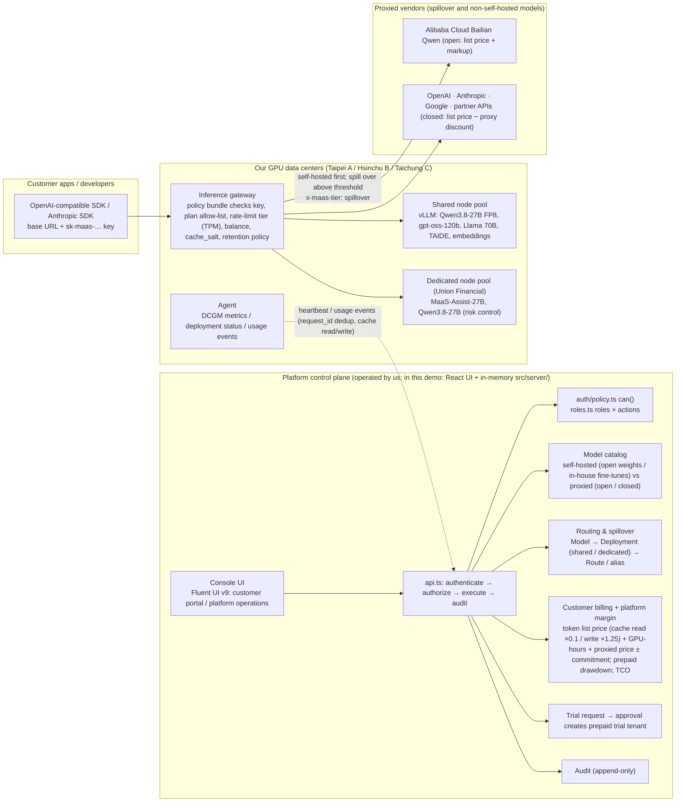

# MaaS Console (Demo) — a Model-as-a-Service console for a "One API" token business

> **Disclaimer**: This project is a **custom demo application**. It shows how the admin console for a GMI Cloud / Inferel-style "sell tokens" MaaS business could be designed: customers use a single key and a single OpenAI-compatible API to call **open models deployed on our own GPUs** and **closed / partner models that we proxy**, and we bill them by tokens, GPU-hours and proxied prices. It **borrows concepts from Azure RBAC** (principal + role + scope = role assignment, scope inheritance, separation of duties) and the **Microsoft Fluent 2 design language**, but it is **not the official Azure Portal**, **does not manage any real Azure resources**, and is not affiliated with Microsoft, GMI Cloud, Inferel, Alibaba Cloud or any model vendor. All customers, users, data centers, GPU metrics, API keys, prices, costs, balances and usage are **fictional demo data**. The roles here are **application roles**, not Azure built-in roles. No Microsoft / Azure logos are used.

## Product: One API, every major model, sustainable pricing

We (the platform provider) own GPU data centers in Taipei (8 × H100), Hsinchu (16 × H200) and Taichung (8 × L40S). On these GPUs we deploy **open-weight** models (Qwen3.8-27B, Qwen3-Embedding-8B, Qwen3-Coder-30B-A3B, gpt-oss-120b, Llama 3.3 70B, Llama-3.1-TAIDE-LX-8B-Chat, EmbeddingGemma) and an **in-house fine-tuned** model (the fictional MaaS-Assist-27B). GPT, Claude, Gemini, Alibaba Cloud Bailian Qwen and image / video / speech models are **proxied** by us. Customers only need one `sk-maas-` key and one base URL (`https://api.maas.example/v1`, plus an Anthropic Messages-compatible `/v1/messages`).

Business model (all numbers are illustrative and can be changed under "Pricing & billing → Pricing parameters"):

- **Self-hosted token list price** (shared deployments): e.g. Qwen3.8-27B US$0.20 / 0.60 per million tokens; **cache read = input list price × 0.1, cache write = input list price × 1.25** (Inferel-style).
- **Dedicated endpoints**: reserved GPU node pools billed at GPU-hours × list price (H100 US$3.9, H200 US$4.9, L40S US$1.4 per GPU-hr). Tokens on the deployment are not billed separately; throughput commitments are written into the contract.
- **Proxied models**: open models (Bailian Qwen, etc.) are **vendor list price + 15% markup**; closed / partner models (OpenAI, Anthropic, Google, Kling / MiniMax) are **vendor list price × (1 − 10% proxy discount)**, while our cost = list price × (1 − 15% negotiated discount) → the proxy margin is the difference between the two discounts. Model Hub cards show "vendor list price → our price".
- **Prepaid credits vs monthly contracts**: pay-as-you-go customers prepay (top-ups of US$10–10,000, drawn down in real time against the statement; when the available balance is ≤ 0 the API returns `402 INSUFFICIENT_CREDITS`; auto-reload is available). Committed-use / dedicated customers are billed monthly (TWD tax invoice), on a single bill.
- **Rate-limit tiers (GMI-style)**: upgraded automatically by cumulative spend — Tier 0 1M TPM (free / trial) → Tier 1 3M (≥ US$50) → Tier 2 50M (≥ US$500) → Tier 3 100M (≥ US$1,000) → Tier 4 300M (monthly contract).
- **SLA**: shared 99.9%, dedicated 99.9% + throughput commitment; monthly availability below 99.9 / 99.0 / 95.0% earns a 10 / 25 / 100% service credit.
- **Zero retention**: each tenant (overridable per project) chooses `zero` (only metering events are kept) or `30d`; exposed in the `x-maas-retention` response header; zero retention is mandatory for the public sector.
- **Questionnaire-reviewed trials**: the customer fills out the "Request testing" questionnaire in the Model Hub → the platform reviews it → approval creates a **prepaid trial tenant** (US$20 free credit, Tier 0, self-hosted only, 3 business days) → a top-up converts it to paid (trial funnel on the Overview page).

The routing plane keeps its original rules: **self-hosted first, spill over to cloud** (spill over when both the per-replica wait queue and KV cache utilization exceed thresholds *and* the tenant has signed cross-border consent for the target region; returns 200 + `x-maas-tier: spillover`), **self-hosted only** (sensitive / public sector / dedicated: when capacity is exhausted return `429 local_capacity_exhausted` + `Retry-After`), and **public sector** (server-enforced self-hosted only, models of Chinese origin excluded, zero retention).

The demo shows the information architecture, RBAC model and security boundaries an enterprise-grade MaaS control plane should have:

- **Server-side authorization**: the UI can only access data through `src/server/api.ts`; every API authenticates and authorizes on the "server" (simulated in memory here) and writes an audit record. Hiding or disabling buttons in the UI is a usability concern, **not** a security boundary.
- **Centralized policy evaluator**: `can(principal, action, scope): Decision` computes effective permissions from direct + inherited assignments, denies by default, and returns the reason for allow / deny along with the source assignment.
- **Separation of duties**: assignments of privileged roles (Platform Owner, Customer Admin) must be approved by a **different principal**; self-elevation and cross-tenant grants are forbidden. Platform-level resources (data centers, pricing & billing, trial review, routing) belong only to our roles: customers can't even see those navigation groups, and calling the API directly returns 403.
- **Audit**: every change (including top-ups, retention toggles and pricing parameters) and every denied attempt records the actor, principal, action, scope, decision, requestId and before / after values.

## Getting started

### Quick start

1. **Make sure Node.js is ≥ 20.19** (developed with v22.15.0). On older versions (e.g. v14 / v16) Vite fails immediately with `SyntaxError: Unexpected token '||='`.
   ```bash
   node -v
   # Switch versions with nvm (Windows: nvm-windows; macOS / Linux: nvm)
   nvm install 22.15.0
   nvm use 22.15.0
   ```
2. **Get the source and install dependencies**
   ```bash
   git clone https://github.com/kuomingwu/mass-demo.git
   cd mass-demo
   npm install
   ```
3. **Start the dev server**
   ```bash
   npm run dev
   ```
   Open <http://localhost:5173/#/> in your browser. (If port 5173 is taken, Vite picks the next free port — use the one printed in the terminal. To allow other devices on your LAN to connect, run `npm run dev -- --host`.)
4. **Stop**: press `Ctrl + C` in the terminal.

The demo has no backend or database — all data is simulated in browser memory, so no environment variables or API keys are needed.

### All commands

```bash
npm install
npm run dev        # Dev server (HashRouter, default http://localhost:5173/#/)
npm run build      # Type-check + build to dist/ (base: './', so dist/index.html works from any static host or via file://)
npm run preview    # Preview dist/
npm test           # vitest: policy / authorization, clusters / deployments / billing / tenants, business model, Model Hub, flow diagrams, route smoke tests, i18n quality gates
```

On first launch a **platform tour** plays automatically (you can "Skip" at any time; once finished or skipped it is recorded under the `maas-demo-tour-v1` key in `localStorage` and won't pop up again). You can reopen it later from the "Help" button in the top right, or via "Settings → Onboarding → Replay".

Once the app is open, use the **demo persona switcher** in the top right to switch between 11 personas. Our roles: Platform Owner (Ms. Liang), Platform Operations (Lin), Platform Finance (Kuo). Customer roles: Customer Admin for Xingyao (monthly contract), Customer Project Operator, Viewer, Access Administrator, Auditor, Customer Finance for Union Financial, public-sector Customer Admin (prepaid, zero retention), and Trial Customer Admin for ACME (US$20 free credit, Tier 0). After switching, our roles land on "Overview" and customers land on "Model Hub"; customer headers show "Balance US$…" (prepaid) or "Monthly · Tier 4". The "Settings" page has "Simulate errors", "Simulate self-hosted capacity exhausted" and "Simulate cluster outage" toggles plus a "Call API directly" button; pricing parameters live under "Pricing & billing".

## Architecture



## Folder structure

```
demo/
├── index.html
├── package.json
├── tsconfig.json
├── vite.config.ts            # base: './', vitest config
├── README.md
└── src/
    ├── main.tsx              # ThemeProvider → SessionProvider → NotifyProvider → HashRouter
    ├── app/
    │   ├── AppShell.tsx      # 48px header (customer balance), 240px collapsible nav (customer portal / platform operations / account & team / guides), persona landing pages, footer disclaimer
    │   ├── routes.tsx        # HashRouter route table (/ redirects customers to /hub)
    │   ├── SessionContext.tsx# demo persona switcher, tenant selection, canUi, simulation toggles
    │   └── __tests__/smoke.test.tsx
    ├── auth/
    │   ├── types.ts          # Action (incl. billing.topup, trial.review…), RoleId (incl. finance)
    │   ├── scope.ts          # scope path utilities (segment-wise matching; /clusters/{c} is platform-level)
    │   ├── roles.ts          # role definitions, roles × actions matrix, vendor roles (VENDOR_ROLES), high-risk combination warnings
    │   ├── policy.ts         # can() centralized policy evaluator, delegated scopes, self-elevation levels
    │   └── __tests__/policy.test.ts
    ├── server/
    │   ├── api.ts            # MockServer: clusters / deployments / routing & spillover / tenants (billing mode, balance, retention) / keys / Playground (402, x-maas-retention / x-maas-balance) / Model Hub / trial requests / accounts (getTenantAccount, topUpCredits, updateTenantRetention) / statements / revenue & margin / unit prices / pricing parameters / IAM / audit
    │   ├── seed.ts           # tenants (plan, billing mode, balance, retention, tier policy, allowed models, commitments, cross-border consent) / projects / users / keys / assignments / persona list (incl. trial tenant ACME)
    │   ├── audit.ts          # audit store and requestId
    │   ├── usage.ts          # usage data generator (tiers local / spillover / cloud, cache read / write tokens, GPU-hr)
    │   └── __tests__/        # connect, clusters, hub, commercial (top-ups / 402 / tiers / cache read-write / proxy margin / retention / funnel)
    ├── data/
    │   ├── commercial.ts     # business-model constants: billing modes, retention, top-up range, cache multipliers, proxy price policy (proxyKindOf / customerPriceFactor / vendorCostFactor), rate-limit tiers, SLA
    │   ├── models.ts         # model catalog (self-hosted list prices, vendor list prices for proxied models, origin, licenseType, deployable; Model Hub fields derived by withHubFields())
    │   ├── providers.ts      # proxied vendor endpoints, self-hosted inference tier summary, routes (placementPolicy, spillover)
    │   ├── clusters.ts       # our clusters / node pools / nodes / deployments, GPU specs and list prices / TCO, VRAM fit, internal cost and margin formulas
    │   ├── guides.ts         # 12 guides (customer journey / platform operations; interactive steps driven by data-tour anchors)
    │   └── guideFlows.ts     # scenario flow diagram for each guide (SVG swimlanes)
    ├── components/           # PageHeader, States, StatusBadge, TopUpDialog, OnboardingTour (tour engine), ScenarioFlow, ConfirmDialog, CodeBlock, charts/…
    ├── pages/
    │   ├── hub/              # HubPage (Model Hub: hero / sources / Model Hub cards (vendor list price → our price) / SLA / public pricing API example / integrations / FAQ / GPU rental), ModelHubGrid, ModelApiDialog, TrialRequestPage, hubContent.ts
    │   ├── PlanPage.tsx      # Trial & plan: billing mode, balance and drawdown, top-up, trial status, rate-limit tier table, retention, SLA
    │   ├── TrialsPage.tsx    # trial request queue and review (platform operations); tenants/TrialRequestsTab
    │   ├── PricingPage.tsx   # Pricing & billing: platform revenue & margin / unit price & margin (per deployment) / proxied model pricing / pricing parameters
    │   ├── clusters/         # ClustersPage, ClusterDetailPage, RegisterClusterDrawer
    │   ├── deployments/      # DeploymentsPage, CreateDeploymentDrawer, DeploymentsTable, ScaleDeploymentDialog
    │   ├── tenants/          # CreateTenantDrawer (customer onboarding), TrialRequestsTab
    │   ├── providers/        # ConnectProviderDrawer
    │   ├── iam/              # five tabs and the multi-step assignment drawer
    │   └── …                 # Overview (platform operations KPIs), Models, Providers, Routing, Tenants, TenantDetail (balance / tier / retention cards), Keys, Playground, Usage (usage / statement), Audit, Guides, Settings
    ├── hooks/useApi.ts
    └── theme/
```

## Object model

```
Cluster (our data center; /clusters/{c})  state machine: awaiting join → connected / disconnected / degraded / missing prerequisites
├── NodePool (shared | dedicated → tenantId)
│   └── Node (DCGM: GPU model × count, allocated / available, memory, SM utilization, idle, MIG)
└── Deployment (Model × Cluster × sharing (shared / dedicated + tenant) × engine × quantization × replicas × autoscaling × rollout; created by platform operations)
      creating → ready / scaled to zero / error

Tenant (customer: plan payg / committed / dedicated, billingMode prepaid / postpaid, credits{balanceUsd, autoReload?, trial?}, retention zero / 30d, dataClass, allowedTiers, allowedModels, excludeOrigins, commitment, quotas, cost center, billing contact, crossBorderConsent)
└── Project (retention override) → API Key (sk-maas-, hash only, partial hint, tier restriction, expiry ≤ 90 days / ephemeral ≤ 1 hour, budget + period, tpm / rpm / concurrency, auto-rotation)

Model (catalog): self-hosted (providerId vllm; priceInput/Output = our list price)
                 vs proxied open (bailian: vendor list price → + markup) vs proxied closed / partner (openai / anthropic / google / partner: vendor list price → − proxy discount; cost − negotiated discount)
Route / alias (public model name → target weights, fallback chain, placement policy, spillover{enabled, threshold, target})
TrialRequest (questionnaire → pending / approved / rejected → tenantId); TopUpRecord (topup / trial-grant / auto-reload)
```

## Scope hierarchy and principals

```
/                                   Platform (us: clusters, deployments, tenant creation, trial review, pricing & billing, proxied vendors, routing)
├── /clusters/{clusterId}           Our GPU clusters (platform-level resource; always denied to customer principals)
└── /tenants/{tenantId}             Customer tenants (Xingyao t-star, Union Financial t-union, Demo City Government IT Bureau t-gov, ACME trial t-acme-trial)
    └── /tenants/{t}/projects/{p}   Projects
        ├── …/keys/{k}              API keys (resource)
        └── …/routes/{r}            Model routes (resource)
```

- Principals: users, groups and service principals (each API key maps to one service principal). Group membership is resolved from a trusted seed (simulated IdP) and is never trusted from the client.
- Scope matching is **segment-wise**: `/tenants/t-star` is an ancestor of `/tenants/t-star/projects/p-cs-bot`, but not of `/tenants/t-star2`.
- **Tenant boundaries are verified independently**: a principal belonging to one customer can never access another customer's scopes (including accounts, top-ups and statements), no matter what scope the client sends, and can never be granted platform or cluster scope.
- **Public-sector customers** (t-gov) are server-enforced as "self-hosted only", with models of Chinese origin excluded (including MaaS-Assist-27B, which is fine-tuned from Qwen) and zero retention (cannot be changed to 30 days). Legal basis: Taiwan's *Principles for Restricting Government Agencies' Use of Products that Endanger National Cyber Security* (issued 2019, amended 2022-11), the Executive Yuan cabinet resolution of 2025-02, and the Ministry of Digital Affairs / Mainland Affairs Council clarification of 2025-11-17 (shared string `PUBLIC_SECTOR_LEGAL_BASIS`).
- **Cross-border data transfer consent** (`Tenant.crossBorderConsent`): spillover or proxying only sends requests to regions the customer has consented to; if the target region is not on the consent list the request is treated as "self-hosted only" (`429 local_capacity_exhausted`, `x-maas-deny-reason: no_cross_border_consent`).
- **Least privilege for API key service principals**: each key's service principal only gets `inference-caller` (`playground.invoke` + `model.read` + `project.read`).

## Roles × actions matrix

Source: `src/auth/roles.ts` (also rendered live in IAM → "Roles" tab). ✓ = allowed. Our roles are Platform Owner, Platform Operations and Platform Finance (assignable only at platform scope); the rest are customer roles.

| Action | Platform Owner | Platform Ops | Platform Finance | Customer Admin | Access Admin | Project Operator | Auditor | Customer Finance | Viewer | Inference Caller (key SP) |
|---|:-:|:-:|:-:|:-:|:-:|:-:|:-:|:-:|:-:|:-:|
| model.read | ✓ | ✓ | ✓ | ✓ | | ✓ | ✓ | | ✓ | ✓ |
| model.route.update (platform-level) | ✓ | | | | | | | | | |
| provider.read | ✓ | ✓ | ✓ | ✓ | | ✓ | ✓ | | ✓ | |
| provider.configure | ✓ | | | | | | | | | |
| cluster.read | ✓ | ✓ | ✓ | | | | | | | |
| cluster.register | ✓ | ✓ | | | | | | | | |
| cluster.operate | ✓ | ✓ | | | | | | | | |
| deployment.read | ✓ | ✓ | ✓ | ✓ | | ✓ | ✓ | | ✓ | |
| deployment.manage | ✓ | ✓ | | | | | | | | |
| key.read / create / revoke | ✓ | | | ✓ | | ✓ | read | | read | |
| playground.invoke | ✓ | | | ✓ | | ✓ | | | | ✓ |
| usage.read | ✓ | ✓ | ✓ | ✓ | | ✓ | ✓ | ✓ | ✓ | |
| billing.read | ✓ | | ✓ | ✓ | | ✓ | ✓ | ✓ | ✓ | |
| billing.export | ✓ | | ✓ | ✓ | | | | ✓ | | |
| billing.topup | ✓ | | ✓ | ✓ | | | | ✓ | | |
| billing.configure | ✓ | | ✓ | | | | | | | |
| tenant.read | ✓ | ✓ | ✓ | ✓ | ✓ | ✓ | ✓ | ✓ | ✓ | |
| tenant.create | ✓ | | | | | | | | | |
| tenant.update (incl. retention policy) | ✓ | | | ✓ | | | | | | |
| trial.review (platform-level) | ✓ | | ✓ | | | | | | | |
| project.read / create / update / delete | ✓ | | read | ✓ | read | read+update | read | read | read | read |
| iam.read / assign | ✓ | | | ✓ | ✓ | | read | | read | |
| iam.approve | ✓ | | | ✓ (tenant scope; cannot approve own requests) | | | | | | |
| audit.read / export | ✓ | | | ✓ | read | | ✓ | | | |

Additional rules (enforced in `api.ts`):

- **Privileged role** (Platform Owner, Customer Admin) assignments: a platform-level principal's assignment takes effect immediately in a scope where it holds `iam.approve`; a privileged assignment requested by a Customer Admin is still created as `pending` and must be approved by **another** principal with `iam.approve`. The approver **may not** be the requester or the beneficiary; pending requests at platform scope can only be approved by the Platform Owner.
- **Delegated scope**: an assigner may only assign within scopes (and their children) where they hold `iam.assign`. **Self-elevation**: you cannot assign yourself (or a group you belong to) a role above your current level. **Cross-tenant**: the principal's tenant must match the target scope's tenant; our roles can only be assigned at platform scope.
- **Clusters are platform-level resources**: `listClusters` / `getCluster` / `registerCluster` return 403 to customer roles; `listDeployments` is filtered for customers to "shared deployments of models allowed by their plan" + "deployments dedicated to them"; a dedicated deployment for a tenant that excludes the model's origin returns `400 MODEL_NOT_ALLOWED`. Cluster registration requires Kubernetes ≥ 1.32, and the one-time join token is created as a Secret with `--from-file`.
- **Dedicated node pools never silently borrow from shared pools**: when sold out they return `409 DEDICATED_POOL_EXHAUSTED` unless `allowSharedFallback: true` is set explicitly (audited). **VRAM fit includes KV cache** (27B BF16 / 131k / 128 seqs doesn't fit on 1 × H100; gpt-oss-120b is MXFP4-only → `QUANT_NOT_SUPPORTED`).
- **Plan allow-list**: keys and the Playground can only use models in the tenant's `allowedModels` whose origin is not excluded; self-hosted-only keys may pick "self-hosted first" aliases, but exhausted capacity returns 429 with no spillover. Key expiry ≤ 90 days is compared in calendar days.
- **Routes are platform-level resources**: only the Platform Owner has `model.route.update`; the primary target of a self-hosted-first route must be self-hosted, and cloud can only be reached via `spillover`; `prefer-intl` / `intl-only` cannot include `cn-beijing`; the spillover threshold is per-replica wait queue AND KV cache utilization. Responses include `x-maas-model` showing the model actually served.
- **Prepaid balance**: `invokePlayground` checks the available balance (ledger − month-to-date statement) after authorization and tenant checks, before routing; ≤ 0 returns `402 INSUFFICIENT_CREDITS` (audited as deny), and successful responses carry `x-maas-balance` (`postpaid` for monthly billing). `topUpCredits` requires `billing.topup` at tenant scope, only accepts prepaid tenants (monthly → `409 NOT_PREPAID`), US$10–10,000, and the audit record includes the balance before and after.
- **Retention policy**: `updateTenantRetention` requires `tenant.update`; the public sector cannot switch to `30d` (400); every Playground response (including 402 / 429) carries `x-maas-retention` (project override takes precedence).
- **Dedicated token coverage is a per-deployment rule**: tokens served by a dedicated deployment are not billed separately; the same tenant's tokens served by shared deployments are billed at list price. A newly created dedicated deployment does not retroactively cover tokens already served by shared deployments.
- **Other tenants' principals are never disclosed**; **inherited assignments** can only be deleted at their source scope (child scope → `409 INHERITED_ASSIGNMENT`).

## Navigation and pages

The left nav has three groups (plus Guides at the bottom):

- **Customer portal** (all roles): Model Hub `/hub` → Playground `/playground` → API keys `/keys` → Usage & billing `/usage` → Trial & plan `/plan`
- **Platform operations** (visible only to our roles; customers opening the URL directly get a server 403): Overview `/`, Trial requests `/trials`, Tenants & projects `/tenants`, Models & deployments `/models` / `/deployments`, Inference clusters `/clusters`, Cloud & partner providers `/providers`, Routing & spillover `/routing`, Pricing & billing `/pricing`, Access control `/iam`, Audit log `/audit`, Settings `/settings`
- **Account & team** (customer roles): Access control, Audit log, Settings
- **Guides** `/guides` (all roles)

After switching persona: our roles → `/`; customers → `/hub` (customers opening `/` are always redirected to the Model Hub). Legacy routes `/usage?tab=unit|revenue` → `/pricing?tab=…`, `/tenants?tab=trials` → `/trials`.

| Route | Page | Highlights |
|---|---|---|
| `#/hub`, `#/hub?tab=integrations`, `#/hub?tab=faq` | **Model Hub** | Customer portal: hero (One API, every major model, sustainable pricing; Get started → API keys, View docs, Request a trial), model source chips, **Model Hub** cards (modality tabs, source: self-hosted GPU / proxied, origin, license, search, price sort; each card: badges, context or pricing unit, **our price** — self-hosted shows a market reference price, proxied shows "vendor list price → our price (+15% markup / −10% proxy discount)", "Try" → Playground preselected, "API" → curl / Python / Node), "More than an API router", "Better economics for the same models" (incl. rate-limit tiers), "From demo to production" (SLA, zero retention, dedicated endpoints, questionnaire-reviewed trials), **SLA & service credits**. Integrations tab: connection info, **`/v1/messages` example**, **public pricing API `GET /v1/models` example response** (incl. `vendor_list_pricing`, cache multipliers, rate-limit tier table), Claude Code / Cursor / Dify / LiteLLM / OpenClaw. FAQ (incl. payment methods), GPU rental. The catalog is filtered server-side by `listHubModels` according to tenant policy |
| `#/hub/trial` | Request testing | Inferel-style 5-section public questionnaire (no login) → `submitTrialRequest` (validation, rate limiting, audit actor=public, status pending) → "Request received" → back to Model Hub |
| `#/playground`, `#/playground?model=…` | Playground | `?model=` preselection; projects / models filtered by permission, simulated streaming, customer charge estimate (self-hosted token list price / dedicated included in GPU-hours / proxied at our price), **response headers** (`x-maas-tier` / `x-maas-model` / `x-maas-region` / `x-maas-deployment` / `x-maas-sharing` / **`x-maas-retention`** / **`x-maas-balance`** / `x-maas-spillover-from` / Retry-After / `x-maas-deny-reason`), **402 INSUFFICIENT_CREDITS with a top-up link**, equivalent `curl -i` |
| `#/keys` | API keys | `sk-maas-` prefix, hash-only storage, tier restriction, model allow-list, expiry ≤ 90 days, auto-rotation |
| `#/usage`, `#/usage?tab=statement` | Usage & billing | Usage tab (charts by tier / vendor / model / status, details including cache read / write, CSV export requires `billing.export`), **Statement** (billing mode and retention badges, **balance drawdown card** for prepaid tenants, (a) self-hosted token charges with cache read / write broken out, (b) dedicated GPU-hours, (c) proxied model lines "vendor list price → our price" split open / closed, (d) commitment adjustment, per-project breakdown, budget alerts, TWD conversion) |
| `#/plan` | **Trial & plan** | Plan · billing mode, available balance (ledger − this month's drawdown) and **top-up** dialog (US$10–10,000), trial status (free credit, expiry), low-balance warning, **rate-limit tier** (current tier, distance to next, GMI-style tier table), retention policy, **SLA & service credits**; our roles can switch to view any tenant |
| `#/` | Overview (platform operations) | KPIs: **tokens this week (self-hosted / proxied)**, **revenue this month** (self-hosted tokens / proxied / dedicated GPU), gross margin, self-hosted GPU utilization, **active tenants · trial funnel** (request → approval → paid conversion), spillover ratio, **SLA attainment**; monthly revenue breakdown card (+ prepaid top-ups, margin), self-hosted GPU vs proxied models, trial funnel card, data center health, proxied vendor health, 24h traffic, recent audit. Customers opening this route are redirected to `/hub` |
| `#/trials` | **Trial requests** | Queue (pending / approved / rejected; seeds: ACME approved → `t-acme-trial`, Demo City Library pending), questionnaire detail drawer, "Approve and create trial tenant" (prepaid, US$20 free credit, Tier 0, self-hosted only, public sector → exclude cn + zero retention, +3 business days, next steps for the customer), reject (reason required); requires `trial.review` (customers and platform operations get 403) |
| `#/tenants`, `#/tenants/:id` | Tenants & projects | List with billing mode and balance; detail: policy, cost center, data classification, cross-border consent, plan · billing mode, **prepaid balance card (top-up)**, **rate-limit tier card**, **data retention card (zero-retention toggle, tenant.update, locked for public sector)**, allowed models, quotas, budgets, deployments serving this tenant, projects; "New tenant" drawer |
| `#/models`, `#/deployments` | Models & deployments | Catalog split into "self-hosted" (our list price) and "proxied" (vendor list price); deployment list with shared / dedicated; create-deployment drawer (VRAM incl. KV cache, node pool, quantization, dedicated tenant, allow borrowing from shared pool) |
| `#/clusters`, `#/clusters/:id` | Inference clusters | Three data centers; four-step "Register cluster" drawer; nodes / deployments / node pools / events tabs. Not visible to customer roles |
| `#/providers` | Cloud & partner providers | Self-hosted inference tier summary + Alibaba Cloud Bailian (open: list price + markup), OpenAI, Anthropic, Google, partner APIs (closed: list price − proxy discount); "Connect provider" wizard |
| `#/routing` | Routing & spillover | Alias → target weights, fallback chain, placement policy, allowed regions, spillover threshold and target; response header and error code docs |
| `#/pricing?tab=revenue|unit|proxy|settings` | **Pricing & billing** | **Platform revenue & margin** (revenue = Σ statements, self-hosted tokens / proxied / dedicated / commitments, prepaid top-ups, GPU TCO, proxied: vendor list price → our cost → revenue and open / closed margin, per customer, GPU fleet cost, per-model margin), **Unit price & margin (per deployment)** (internal cost, floor at 100% utilization, utilization u* needed for 40% margin, market reference price, comparable proxied price), **Proxied model pricing** (per proxied model: vendor list price → our price → our cost → unit margin), **Pricing parameters** (token list prices, cache read / write multipliers, GPU list prices and TCO, proxy markup %, proxy discount %, negotiated discount %, exchange rate; requires `billing.configure`). Only for platform-scope `billing.read` (Owner / Finance) |
| `#/iam` | Access control | Scope picker + breadcrumbs; role assignments / role matrix / effective access / pending requests / audit; multi-step "Add assignment" drawer |
| `#/audit` | Audit log | Filters, expandable before / after (incl. `billing.topup`, `tenant.update` retention, `trial.review`), export requires `audit.export` |
| `#/guides` | Guides | 12 scenario guides grouped as "Customer journey" / "Platform operations": step-by-step instructions, scenario flow diagrams (SVG swimlanes), one-click interactive tour |
| `#/settings` | Settings | Theme, demo toggles (simulate errors / self-hosted capacity exhausted / cluster outage), inference gateway notes, onboarding replay, "Call API directly" demo, pricing parameters link, disclaimer |
| Other | 403 / 404 | The access-denied page includes a "Request access from an access administrator" link |

### Guides

Customer journey:

1. **From Model Hub to your first API call (interactive)**: Customer Admin — Model Hub (vendor list price → our price) → filter self-hosted GPU → model card "API" → create key → Playground (`?model=` preselected) → response headers (tier / retention / balance)
2. **Create an API key and test it (interactive)**
3. Access denied (403) and requesting access (customers can't see the "Platform operations" group)

Platform operations:

4. **Platform tour** (the two paths of One API: customer portal vs platform operations; Overview KPIs; trial requests → deployments → pricing & margin)
5. **Customer requests testing → platform approves and creates a trial tenant (interactive)**: Model Hub "Request a trial" → questionnaire → approve in `/trials` → prepaid trial tenant
6. **Register a cluster (interactive)** 7. **Deploy a model: shared vs dedicated (interactive)** 8. **Add a tenant: customer onboarding (interactive)**
9. **Connect a proxied vendor: Alibaba Cloud Bailian (interactive)** 10. Self-hosted first and spillover 11. **Add a role assignment and approve it (interactive)**
12. Billing customers and platform margin (Usage & billing → Statement → export → Pricing & billing: revenue / unit price / proxied pricing / pricing parameters)

## Trial request flow (Inferel-style)

1. **Public questionnaire (visitor)**: S1 trial terms (US$20 free credit, 3 business days; test account name, IP allow-list) → S2 models to test (RPM / TPM / TTFT / cache hit rate) → S3 scenario, use case, routing preference, monthly tokens, concurrency, local requirements (data stays in Taiwan, public sector, invoices) → S4 other requirements → S5 contact information.
2. **Server `submitTrialRequest`** (no login): validation, rate limiting (max 3 pending per email, 20 per minute), duplicate account name → 409, status `pending`, audit `trial.submit` (actor=public). No tenant or key is created.
3. **Platform review** (`trial.review`: Platform Owner, Platform Finance): `#/trials` queue → details → **Approve and create trial tenant** (`approveTrialRequest`: plan payg, `billingMode: prepaid`, `credits.balanceUsd = 20` (top-up record `trial-grant`), `credits.trial.expiresAt = +3 business days`, `allowedTiers: local`, public sector → `excludeOrigins: ['cn']` + `retention: 'zero'`, allow-list = requested models (unavailable ones removed with an explanation), cost center `TRIAL-<account>`); or reject (reason required). Audit `trial.review` (before / after). A trial tenant's first `topUpCredits` or switch to monthly billing counts as a "paid conversion" on the Overview.

## Billing formulas

```
Customer monthly statement
  (a) Self-hosted token charges = Σ (model × serving deployment) [(input − cache read − cache write) × input list price + cache read × input list price × 0.1 + cache write × input list price × 1.25 + output × output list price] ÷ 1e6
       Illustrative list prices: Qwen3.8-27B 0.20/0.60, gpt-oss-120b 0.15/0.60, Llama 3.3 70B 0.25/0.50, MaaS-Assist-27B 0.40/1.20, TAIDE 0.15/0.30, Qwen3-Embedding 0.05, EmbeddingGemma 0.01 (USD per million tokens)
       (tokens on usage rows served by a dedicated deployment are not billed — they're included in (b); rows for the same model served by shared deployments are billed at list price)
  (b) Dedicated endpoint charges = Σ dedicated deployments ∫period [replicas(t) × GPUs per replica] dt × GPU list price (H100 US$3.9, H200 US$4.9, L40S US$1.4 per GPU-hr)
  (c) Proxied models = Σ models: open models (providerId bailian) vendor list price × (1 + 15%); closed / partner (openai / anthropic / google / partner) vendor list price × (1 − 10%)
       (usage that spills over to proxied models follows the same policy; individual models can override proxyDiscountPct)
  Subtotal = (a) + (b) + (c)
  (d) Committed-use plan (plan = committed): period commitment = monthly commitment × days ÷ days in month; discount = period commitment × 15%; overage = max(0, subtotal − period commitment); shortfall true-up = max(0, period commitment − subtotal)
       Total = subtotal − discount + shortfall true-up; other plans: total = subtotal
  TWD note = total × exchange rate (illustrative 32.5)

Prepaid credits (billingMode = prepaid)
  Available balance = credits.balanceUsd (ledger of top-ups) − month-to-date statement total
  Available balance ≤ 0 → Playground / API 402 INSUFFICIENT_CREDITS; ≤ low-balance threshold (autoReload.thresholdUsd or US$100) → warning
  Top-ups US$10–10,000 (billing.topup; audit records balance before / after); the US$20 trial grant is recorded as trial-grant
  Rate-limit tier = tierForSpend(cumulative spend (statement totals for the months covered by usage), monthly contract): 0→1M, ≥50→3M, ≥500→50M, ≥1,000→100M; monthly contract → Tier 4 300M TPM

Platform revenue and margin (us)
  Revenue = Σ statement totals of all tenants (the same number appears on Overview, Pricing & billing and Σ statements)
  GPU cost (TCO) = Σ data center GPU count × TCO per GPU-hr × hours in period (including idle and degraded; illustrative H100 US$2.0, H200 US$2.4, L40S US$0.6)
  Proxied vendor cost = Σ open model vendor list price + Σ closed model vendor list price × (1 − 15% negotiated discount)
  Gross margin = revenue − GPU TCO − proxied vendor cost; margin % = gross margin ÷ revenue
  Proxy margin %: open = 15 ÷ 115 ≈ 13.0%; closed = (0.9 − 0.85) ÷ 0.9 ≈ 5.6%
  Prepaid top-ups = top-ups received this month (prepaid; recognized as revenue only when consumed)
  Deployment internal cost (USD per million tokens) = GPU TCO × GPUs per replica ÷ (tok/s × utilization × 3600) × 1e6
  Blended list price = 70% input list price + 30% output list price; token margin % = (blended list price − internal cost) ÷ blended list price
  Utilization needed for 40% margin u* = cost at 100% utilization ÷ (blended list price × 0.6) (> 1 means the target is unreachable at this list price)
  Dedicated deployment margin % = (GPU list price − TCO) ÷ GPU list price

Throughput (single lookup tokPerSecPerGpu, src/data/clusters.ts)
  tok/s per GPU = GPU reference value (27B dense FP8: H100 4,000, H200 5,500, L40S 1,100) × (27 ÷ parameter count)^0.8 (capped at 4×; MoE uses active parameters then × 0.6; embeddings × min(16, 27 ÷ parameter count) × 3) × quantization factor (BF16 0.7 / FP8 1 / INT4 1.15)
  tok/s per replica = per GPU × GPU count × tensor-parallel efficiency (1 GPU 1.0, 2 GPUs 0.9, ≥ 4 GPUs 0.8)
```

All list prices, multipliers, TCO, markups, discounts and exchange rates are adjusted under "Pricing & billing → Pricing parameters" (requires `billing.configure`: Platform Owner, Platform Finance; audited with before / after). Statements, Model Hub card prices and platform revenue & margin recalculate immediately.

Usage seed data is generated **supply-side** (`src/server/usage.ts`): each ready deployment's daily tokens = tok/s × replicas × utilization × 86,400 × daily factor, then split across projects by `DEPLOYMENT_CONSUMERS` weights; self-hosted rows additionally mark cache reads (20–40% of input) and cache writes (5–10% of input). Demo figures (2026-11-01 to 11-08, 8 days): revenue US$17,732 (self-hosted tokens ≈ US$7,853, proxied ≈ US$2,953, dedicated ≈ US$7,526, commitment adjustment −US$600), gross margin ≈ 21%; prepaid top-ups this month US$2,020 (public-sector auto-reload 2,000 + trial grant 20); public-sector prepaid ledger US$4,000, drawdown this month ≈ US$1,070, Tier 3; ACME trial balance US$20, Tier 0; weighted utilization of connected data centers 57%; about 1.4% of requests spill over.

## Developer interface (API shape)

- Base URL `https://api.maas.example/v1` (illustrative): `POST /v1/chat/completions`, `GET /v1/models` (**public pricing API**: our price for each model, `vendor_list_pricing` for proxied models, cache multipliers for self-hosted models, rate-limit tier table), routed by the `model` string (alias). Also `/v1/messages` (Anthropic Messages-compatible adapter; for Claude Code use `ANTHROPIC_BASE_URL=https://api.maas.example`), `/v1/embeddings`, `/v1/rerank`, `/v1/images/generations`, `/v1/videos`, `/v1/audio/speech` / `/v1/audio/transcriptions`.
- Response headers: `x-maas-tier: local|spillover|external`, `x-maas-served-by`, `x-maas-model`, `x-maas-deployment`, `x-maas-region`, `x-maas-sharing`, `x-maas-cluster`, **`x-maas-retention: zero|30d`**, **`x-maas-balance`** (prepaid available balance; `postpaid` for monthly billing), `x-maas-spillover-from`, `x-maas-spillover-reason`, `x-maas-deny-reason`, `x-maas-route`, `x-maas-request-id`.
- Error codes: **`402 INSUFFICIENT_CREDITS`** (prepaid balance exhausted), `429 local_capacity_exhausted` (with `Retry-After: 15`), `429 rate_limit_error/quota_error`, `503 DEPLOYMENT_SCALING_UP`, `503 NO_CAPACITY`, `400 TIER_NOT_ALLOWED`, `400 MODEL_NOT_ALLOWED`, `400 INSUFFICIENT_VRAM`, `400 QUANT_NOT_SUPPORTED`, `400 INSUFFICIENT_GPUS`, `409 DEDICATED_POOL_EXHAUSTED`, `409 CLUSTER_NOT_CONNECTED`, `409 DEPLOYMENT_IN_USE`, `409 NOT_PREPAID` (top-up on a monthly-billed tenant), `400 CROSS_BORDER_CONSENT_REQUIRED`, `400 KEY_EXPIRY_REQUIRED/KEY_EXPIRY_TOO_LONG/EPHEMERAL_TOO_LONG`.

## Security boundaries

1. **Server-side enforcement**: every `MockServer` API first calls `authenticate(session)` and then `authorize(principal, action, scope)`; collection APIs **filter results down to authorized rows**. Platform-level APIs (clusters, pricing & billing, trial review, routing) return `403` to customer roles; not signed in → `401`, not found → `404`, state conflict → `409`, insufficient balance → `402`.
2. **Deny by default**: if no effective assignment grants the action, it is denied; `Decision.reason` explains why.
3. **Audit**: all changes and denials are appended to a read-only audit store with a `requestId`.
4. **The UI is not the boundary**: customer roles can't see the "Platform operations" nav group, but typing `/pricing`, `/trials` or `/clusters` directly still gets a 403 from the server. The "Call API directly" button on the Settings page bypasses all UI checks to attempt self-elevation; everyone except the Platform Owner gets a 403 and an audit record.
5. **Success messages only appear after the server responds**: no optimistic updates.
6. **Data-plane boundary**: key validation, plan allow-lists, rate-limit tiers, balances and retention policies are enforced by the inference gateway in our data centers using a signed policy bundle; usage events (request_id dedup, cache read / write, shared / dedicated) are reported back to the control plane for billing (simulated in the control plane in this demo).

## Internationalization (i18n)

- **Locales**: Traditional Chinese `zh-TW` (source language), English `en`, Japanese `ja`. A home-grown lightweight i18n (`src/i18n/`, no third-party packages): flat dictionaries + `{name}` interpolation + `Intl.PluralRules` plurals + `Intl` number / date formatting (US$ amounts are the same in every locale; New Taiwan dollars are `NT$` in zh-TW / ja and `TWD` in en).
- **Switching**: the globe button in the header (`data-tour="lang-switch"`; the menu shows each language's native name). The choice is stored under `maas-demo-lang` in `localStorage`, re-renders immediately and updates `<html lang>` (`zh-Hant-TW` / `en` / `ja`). First-time visitors (no choice yet) always see **English** (`INITIAL_LOCALE = 'en'`, see `src/i18n/core.ts`; `detectLocale` is kept so browser detection can be restored; tests are pinned to zh-TW). zh-TW remains the source language and final fallback.
- **Fallback**: ja → en → zh-TW, en → zh-TW. If a key is missing in all three, the key itself is returned and `console.warn('[i18n] missing key: …')` is logged in dev mode — blank text is never rendered. zh-TW output is byte-for-byte identical to the pre-i18n version.
- **Keys and dictionaries**: `src/i18n/dict/<locale>/<area>.ts` (12 areas: common, shell, overview, data, server, guides, flows, hub, billing, ops, customer, admin), 3,439 keys per locale; the key sets of all three locales must be identical. Key naming is `<area>.<page>.<element>`; enums use `data.<MAP>.<value>` (`tl()`); data-driven text uses `tf(t, key, zhFallback)`; server messages carry `messageKey` / `params` and the UI shows them with `apiMessage(t, err)`; seeded tenant / user names use `tenantLabel()` / `principalLabel()`. See [`src/i18n/README.md`](src/i18n/README.md) for full conventions and translation style. Demo proper nouns (tenants, projects, keys, people, data centers) are listed in `src/i18n/allowlist.json` and may stay in Chinese.
- **Test gates**: `src/i18n/__tests__/i18n.test.ts` (identical key sets, non-empty values, no CJK in the en dictionary, no Traditional-only characters in the ja dictionary, source scan finds no leftover Chinese [excluding comments and the allow-list], en / ja rendered nav = dictionary values with no zh-TW leaks, live re-render on language switch) and `routes.i18n.test.tsx` (3 locales × owner / tenant-admin / gov-admin × 55 routes: no unresolved keys, no missing-key warnings, no CJK in en, no verbatim zh-TW copy or Traditional-only characters in ja).
- **Adding a key**: add the same key to the same area file in all three locales (zh-TW first) and use `t('area.page.element')` in the component; run `npm test` to confirm the key-set and leak checks pass.
- **Adding a locale** (e.g. `ko`): add it to `Locale` / `LOCALES` / `LOCALE_NATIVE_NAMES` / `LOCALE_TAGS` / `FALLBACK_CHAIN` / `detectLocale` in `types.ts`; copy `dict/en/` to `dict/ko/` and translate; add a `src/i18n/ko.ts` entry point and register it in `DICTS` in `core.ts`; adjust `applyHtmlLang` in `core.ts` and `format.ts` as needed; add the new locale to `i18n.test.ts` (key sets) and to `LOCALES` in `routes.i18n.test.tsx`.

## Tests

`npm test` runs 9 test files with 640 tests:

- **`src/auth/__tests__/policy.test.ts`**: scope matching, deny by default, inheritance, tenant boundaries, groups, pending / approval / separation of duties, self-elevation, cross-tenant, our roles assignable only at platform scope, UI bypass, delegated scope, inherited deletion, audit, public-sector keys, key expiry, self-hosted-only 429 vs self-hosted-first spillover, role matrix, least privilege for key service principals, no disclosure of other tenants' principals, cross-border consent required for new tenants.
- **`src/server/__tests__/clusters.test.ts`**: cluster registration state machine, customer 403, draining, node pools, VRAM incl. KV cache, dedicated deployments (sold out / borrowing / origin), scaling, dedicated deployments only serve their routes, route validation, cross-border consent, usage seed consistency, **token list prices (cache read × 0.1, write × 1.25)**, unit price and u*, statements (committed / dedicated / public sector; proxied lines open +15% / closed −10%), **platform revenue (4 tenants, proxied open / closed margin, prepaid top-ups 2,020, trial funnel, tokens this week, SLA)**, CSV (`cacheReadTokens,cacheWriteTokens`), **cache read / write multipliers reflected in statements**, commitment shortfall, month consistency, statement totals consistency.
- **`src/server/__tests__/commercial.test.ts`**: rate-limit tiers (thresholds, contract Tier 4, server-side calculation: ACME Tier 0 / public sector Tier 3 / Xingyao Tier 4, cross-tenant 403), **prepaid balance** (available = ledger − this month's drawdown; Playground carries `x-maas-balance`; exhausted balance → **402** and audit; recovers after top-up; monthly → `postpaid`), **top-ups** (10–10,000, RBAC: Customer Admin / Customer Finance / our Finance allowed, Viewer / Platform Operations 403, cross-tenant 403, monthly 409, audit balance before / after, trial top-up → paid conversion), billing mode and initial top-up for new tenants, **proxy price policy** (supply type, customer / cost factors, `proxiedPriceView`, proxied statement lines, recalculation after changing discounts, Playground estimates), CSV / usageCharge use the same policy, **zero retention** (public sector zero, Xingyao 30d, toggle audit, Viewer 403, public sector locked, project override), SLA constants, **trial seed and funnel** (approving a pending request → public-sector prepaid trial tenant with zero retention).
- **`src/server/__tests__/hub.test.ts`**: Model Hub fields (closed models keep vendor list price, `customerUnitPrice` = list price × 0.9, open models × 1.15), `listHubModels` server-side filtering, Playground non-text modalities, `trial.review` is a platform-level action, trial request validation and rate limiting, review RBAC, approval creates a **prepaid** trial tenant (balance 20, retention 30d / public sector zero, +3 business days), duplicate approval 409, rejection requires a reason.
- **`src/server/__tests__/connect.test.ts`**: proxied vendor connection wizard and probing our nodes (customer 403).
- **`src/components/__tests__/scenarioFlow.test.tsx`**: data integrity of the 12 flow diagrams (7–12 nodes, 3–5 swimlanes, decision nodes with labeled outgoing edges, audit nodes), layout and SVG rendering; every guide has a flow diagram.
- **`src/app/__tests__/smoke.test.tsx`**: mounts all 50 routes as 9 personas (including `/plan`, `/trials`, the four `/pricing` tabs, trial tenant detail, legacy route redirects) and checks for runtime errors; **nav grouping** (us: customer portal + platform operations; customers: customer portal + account & team, with no platform operations items; guides for everyone), **home redirects** (customer `/` → Model Hub; we see token-business KPIs; `landingFor`), **platform-level pages return 403** (customers and Platform Operations opening `/clusters` / `/pricing` / `/trials`; Owner / Finance can see them), **trial & plan and header balance** (ACME US$20 / Tier 0, public sector Tier 3, Xingyao monthly Tier 4), statements with cache read / write and proxied prices at our price, Model Hub (proxied card "vendor list price US$1.25 / US$10 → our price (−10% proxy discount)", public-sector filtering, docs tab with `GET /v1/models` / `vendor_list_pricing` / `/v1/messages`, SLA), and the two groups of 12 guides.
- **`src/i18n/__tests__/i18n.test.ts`** (13) and **`src/i18n/__tests__/routes.i18n.test.tsx`** (9): i18n quality gates; see "Internationalization (i18n)" above.

## Simulation vs production

| Area | This demo | Production should be |
|---|---|---|
| Authentication | The persona switcher in the top right sets a mock session; `authenticate()` resolves it from the seed | Microsoft Entra ID / OIDC SSO (us) + federation with customer IdPs |
| Authorization | `can()` runs in the simulated server inside the front-end process | The same policy evaluator deployed in the control-plane API (or a PDP); signed policy bundles pushed to each data center's inference gateway |
| Data center onboarding | `registerCluster()` generates the command and token; a 2-second timer simulates the agent connecting | Install an agent / operator in the new data center that connects back with short-lived credentials; marked disconnected after 10 minutes without a heartbeat |
| GPU metrics | SM utilization, memory, idle and MIG labels in the seed | DCGM Exporter + kubelet podresources + vLLM `/metrics` |
| Deployments | `createDeployment` checks deployability / origin / VRAM / node pool, then becomes ready after a timer | KServe / llm-d / Helm deploying vLLM / SGLang; HPA / KEDA; scale-to-zero |
| Routing & spillover | Spillover / 429 triggered by simulation toggles | The inference gateway routes by per-replica queue and KV cache utilization, exposed via headers |
| Vendor keys | Only shows the reference path in our KMS | KMS / Key Vault with key rotation and access auditing |
| API keys | Random strings, fake hashes; expiry and tier validated by the server | Generated by the control-plane KMS, hash-only storage; policy bundles pushed to gateways |
| Model calls | The Playground simulates token streaming and response headers | Calls deployments or proxied vendors through the inference gateway in OpenAI / Anthropic-compatible formats, streamed back over SSE |
| Billing | A fixed seed generates 39 days of usage (tiers, cache read / write tokens, GPU-hr); proxied cost estimated as list price × factor; TCO is a configured value | Metering pipeline (gateway events deduplicated by `request_id`); proxied vendor bills reconciled in FOCUS format; TCO updated quarterly by finance |
| Prepaid balance & top-ups | `credits.balanceUsd` ledger − this month's statement = available balance; top-ups credited directly (in memory) | Payment / wire transfer posting, balance ledger, low-balance notifications, auto-reload, ledger reset after monthly settlement |
| Rate-limit tiers | Computed from cumulative statements in the usage seed | Enforced per tenant TPM by the gateway; tier-change notifications |
| Zero retention | Tenant / project fields + response header | Gateway and inference engine never persist prompts / responses; ZDR contracts with proxied vendors |
| Tenant onboarding / trials | `createTenant()` / `approveTrialRequest()` create the tenant and a default project | Triggered by CRM / contract systems, including credit review, contract and SLA terms, invoicing and tax |
| Audit export | CSV generated in the browser | Asynchronous export jobs, signing and retention policies, WORM storage |

### Known simplifications

- The Model Hub is a **preview of the customer portal** inside the console, not a public website; in the demo, "Request testing" is submitted as the currently signed-in persona (the public form does not check permissions). Trial requests, trial tenants, top-up records and retention toggles only live in `MockServer` memory (a page refresh resets to the seed); approval does not automatically assign a Customer Admin or create keys — it only lists the next steps.
- The prepaid balance is derived in real time as "ledger − month-to-date statement" (no per-transaction debits); October is treated as settled and already deducted from the ledger. Cumulative spend (for rate-limit tiers) only covers the months in the usage seed (2026-10, 2026-11). SLA attainment is approximated by this month's request success rate.
- Vendor list prices, proxy discounts, negotiated discounts, markups and non-text modality prices for proxied models are all illustrative; Playground media responses only report unit usage and pricing and don't produce real media; these models have no usage seed and don't appear on statements (Claude Haiku 4.5, Gemini 2.5 Flash and Bailian Qwen do).
- Newly added tenants exist only in `MockServer` (`listTenants` / statements / keys / accounts all work), but the header's tenant picker and some dropdowns read the static `TENANTS` seed and won't list new tenants.
- The usage seed is static: new deployments don't generate new token usage; GPU-hours for dedicated deployments are prorated by the minute within the statement period based on creation time. All throughput (tok/s) figures are estimates.
- The October statement uses a full 31-day month and the same usage seed (illustrative).

## Accessibility and responsiveness

- Fully keyboard-operable, visible focus, semantic tables via Fluent DataGrid, persistent form labels and validation messages.
- Status is always "icon + text", never color alone; charts include a legend and "View data as table".
- Light / dark / high-contrast themes are all built on Fluent semantic tokens (`tokens.*`); chart palettes are checked with the dataviz validator.
- Below 1024px the nav collapses to icons (group titles become dividers); below 700px it is hidden and can be opened from a header button; at 390px width there is no page-level horizontal scroll (wide tables scroll inside their containers).
