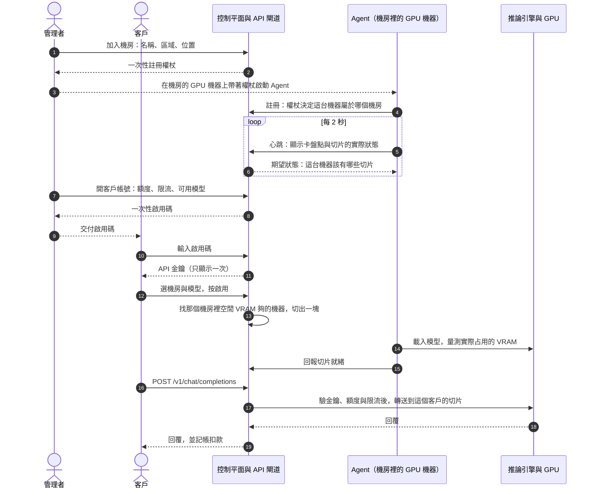

# 本地 GPU POC：節點代理 + 閘道 + 驗收測試

這個資料夾是「把自有 GPU 機器接進 MaaS 平台」的最小可行驗證。它在一台裝有 NVIDIA 顯示卡的電腦上，實際跑完整條路徑：節點代理註冊、GPU 切割、載入模型、OpenAI 相容 API、金鑰與限流、計量扣款、驗收報告。

所有程式都是零相依的 Node.js 腳本（Node 20 以上）。推論引擎用 Ollama。所有持久化資料都寫在 D 槽。

## 0. 最快的走法：一個指令跑完整個流程

用目錄裡最小的模型 `gemma3:270m`（約 290 MB，VRAM 約 0.5 GB），一次走完三件事：加入機房並接上機房裡的 GPU 機器、客戶啟用、客戶自己選機房與模型後由平台切割顯示卡。

```bash
ollama pull gemma3:270m      # 只需要做一次
cd poc
node quickstart.mjs          # 跑完 27 項檢查後繼續提供服務，可用瀏覽器操作
node quickstart.mjs --once   # 跑完就結束，並釋放 GPU 記憶體
```

加上 `--fresh` 會先刪除控制平面的狀態檔，從空白開始。

不加 `--once` 時，腳本最後會印出兩個網址與一組啟用碼：

| 頁面 | 網址 | 給誰用 |
|---|---|---|
| 機房與切割拓樸 | `http://127.0.0.1:8787/topology#<管理者金鑰>` | 管理者：加入機房、開客戶帳號、看每張顯示卡怎麼切 |
| 客戶啟用 | `http://127.0.0.1:8787/portal` | 客戶：輸入啟用碼、拿金鑰、選機房與模型、試打、看用量 |

兩頁並排開著。在啟用頁選機房與模型按「啟用」，拓樸頁會在幾秒內多出一塊切片。按 Ctrl+C 結束。

同樣的操作也可以在示範網站上做，畫面與網站其他頁面一致，支援三種語言：

| 入口 | 頁面 | 啟動方式 |
|---|---|---|
| 管理後台 | 本地 GPU 上線 → 即時拓樸 | `npm run dev:admin`，開啟 `http://localhost:5174/#/local-gpu?tab=topology` |
| 客戶入口 | 自有 GPU 實機 | `npm run dev:customer`，開啟 `http://localhost:5173/#/live-gpu` |

管理金鑰用 `node slice.mjs url` 取得，貼井字號後面那一段。

不想分開啟動的話，在上一層資料夾執行 `npm run live`。它會一次啟動驗證環境與兩個入口，並自動開啟瀏覽器：管理後台已帶入管理金鑰，客戶入口已帶入啟用碼。按 Ctrl+C 全部結束。

報告寫在 `<儲存根目錄>/reports/quickstart-latest.md`。

### 完整流程



### 切割的規則

- **隨需切割**：切割模式設為 `on-demand` 時不預先切好。客戶啟用模型時，控制平面才從空閒的 VRAM 切出一塊。每個模型需要多大，寫在 `poc.config.json` 的 `models.*.sliceMiB`。
- **同一個機房、同一個模型只切一塊**：第二個客戶啟用同一個模型時共用現有的切片，不重複佔用 VRAM。
- **客戶只能用自己啟用過的切片**：能不能用是控制平面依自己的紀錄判斷，不看 Agent 回報的內容。
- **容量不夠就拒絕**：回覆 `409 NO_CAPACITY`，並說明需要多少、最大的空閒區塊多少。
- **沒人用就歸還**：最後一個客戶停用後，切片移除，Agent 卸載模型，VRAM 釋放。
- **機房由權杖決定**：機器屬於哪個機房，取決於管理者發的註冊權杖，不是機器自己宣稱。權杖只能用一次。同一張顯示卡重新註冊時沿用原本的節點紀錄。

也可以不用客戶觸發，由管理者指定固定的切法，見第 5 節與 `node slice.mjs`。

### 切割是直接切主機，不需要先建虛擬機

Agent 與推論引擎直接跑在 GPU 主機的作業系統上（正式環境通常是裸機上的容器）。切片是主機上的一個推論引擎行程加上一份 VRAM 額度。

用 MIG 做硬體切割時也是直接在主機上切，切出來的每一塊再指派給一個容器。只有要把整台機器租給客戶自己管理時，才需要虛擬機與 vGPU 授權，那是另一種產品。

### 相關的 API

| 誰呼叫 | API | 用途 |
|---|---|---|
| 管理者 | `POST /admin/v1/sites` | 加入機房，回傳一次性註冊權杖。對既有機房呼叫會重發權杖 |
| 管理者 | `POST /admin/v1/profile` | 設定切割模式：`on-demand` 或固定配置 |
| 管理者 | `POST /admin/v1/tenants` | 開客戶帳號，回傳一次性啟用碼 |
| 管理者 | `GET /admin/v1/topology` | 機房、機器、顯示卡、切片、客戶與最近事件 |
| 管理者 | `POST /admin/v1/slices/clear` | 清空所有隨需切片 |
| Agent | `POST /agent/v1/enroll` | 用註冊權杖換節點身分 |
| Agent | `POST /agent/v1/heartbeat` | 回報實際狀態，取得期望狀態 |
| 客戶 | `POST /portal/v1/activate` | 用啟用碼啟用帳號，取得第一把金鑰 |
| 客戶 | `GET /portal/v1/sites` | 可用的機房與剩餘容量 |
| 客戶 | `POST /portal/v1/deployments` | 在指定機房啟用模型 |
| 客戶 | `GET /portal/v1/deployments`、`POST /portal/v1/deployments/remove` | 查看與停用已啟用的模型 |
| 客戶 | `GET /portal/v1/me` | 查看餘額、限流、金鑰與今日用量 |
| 客戶 | `POST /portal/v1/keys`、`POST /portal/v1/keys/revoke` | 加開與撤銷金鑰 |
| 客戶 | `GET /v1/models`、`POST /v1/chat/completions` | OpenAI 相容的推論 API |

### 快速驗證的實測結果（2026-11-17）

27 項檢查全部通過，RTX 4080 Laptop 12 GB。

| 動作 | 實測 |
|---|---|
| 客戶啟用 `gemma-3-270m` | 切出 1,024 MiB，8 秒後就緒，實測占用 507 MiB |
| 第二個客戶啟用同一個模型 | 共用同一塊切片，VRAM 沒有增加 |
| 再啟用 `llama-3.2-3b` | 同一張卡切出第二塊 3,584 MiB，實測 2,640 MiB，第一塊持續就緒 |
| 剩 6,138 MiB 時要求 10,496 MiB 的模型 | 拒絕，`409 NO_CAPACITY` |
| 停用 `llama-3.2-3b` | 切片移除，空閒回到 9,722 MiB |

### 與正式環境不同的地方

- POC 的閘道與 GPU 機器是同一台電腦，閘道直接連本機的推論引擎。正式環境的 GPU 機器在機房的網路裡，推論流量要走私有網路（專線或站對站 VPN），或由 Agent 維持一條對外的反向通道。Agent 的註冊與心跳本來就是對外連線。
- POC 只有一台 GPU 機器。機房可以建很多個，但只有一個有機器。多台機器之間的挑選邏輯（選空閒最多的那台）有寫，沒有用兩台實機驗證過。
- 推論引擎是 Ollama，同一個模型只能載入一份，所以同模型共用一塊切片。正式環境用 vLLM 時，同一個模型可以開多個副本。
- 切片是記憶體預算，不是硬體隔離。同一張卡上的切片同時忙碌時會互相拖慢。
- 啟用碼與註冊權杖在 POC 裡直接顯示在畫面上。正式環境寄給對方的管理員，並搭配登入與多因子驗證。拓樸頁的管理者金鑰放在網址裡，也只適合本機示範。
- `gemma3:270m` 只用來證明流程走得通，回答品質不足以商用。

## 1. 先決條件

| 項目 | 這台電腦的現況 |
|---|---|
| NVIDIA GPU 與驅動 | GeForce RTX 4080 Laptop 12 GB，驅動 610.74 |
| Ollama | 0.40.16，服務在 `http://127.0.0.1:11434` |
| 模型權重 | `D:\ollama\models`（環境變數 `OLLAMA_MODELS`） |
| Node.js | 20 以上（實測用 22.15） |

完整驗收（第 2 節）使用三個已下載的模型：`gemma3:4b`、`llama3.2:latest`、`hf.co/audreyt/Gemma-3-TAIDE-12b-Chat-2602-GGUF:Q4_K_M`。缺少時用 `ollama pull <名稱>` 補上。

## 2. 執行

開三個終端機，都進到這個資料夾（需要 Node.js 20 以上）：

```bash
cd poc
```

```bash
node gateway.mjs                  # 終端機 1：控制面 + 閘道，127.0.0.1:8787
node agent.mjs                    # 終端機 2：節點代理，註冊後載入切片
node bench.mjs --with-dedicated   # 終端機 3：23 項驗收 + 壓測，約 3 分鐘
```

結束時釋放 GPU 記憶體：

```bash
node agent.mjs --release
```

把最新實測結果更新到示範網站的「本地 GPU 上線」頁：

```bash
node export-snapshot.mjs          # 寫入 ../src/data/localGpuPoc.snapshot.json
```

## 3. 檔案

| 檔案 | 角色 |
|---|---|
| `poc.config.json` | 儲存位置、切片設定檔、模型對照與單價、測試租戶 |
| `gateway.mjs` | 控制面與資料面：節點註冊與心跳、期望狀態、`/v1/models`、`/v1/chat/completions`、開戶與啟用碼、金鑰、目錄白名單、TPM 限流、預付餘額、帳本 |
| `agent.mjs` | 節點代理：盤點 GPU、註冊、心跳、准入控制、載入與卸載模型、量測 VRAM |
| `quickstart.mjs` | 一個指令走完加入機房、接上 GPU 機器、客戶啟用與隨需切割，27 項檢查，輸出報告 |
| `portal.html` | 客戶頁：啟用、金鑰、選機房與模型、試打、用量，由閘道在 `/portal` 提供 |
| `topology.html` | 管理者頁：加入機房、開客戶帳號、即時的切割拓樸，由閘道在 `/topology` 提供 |
| `slice.mjs` | 手動套用固定的切法並查看結果：`list`、`apply <配置>`、`status`、`stop` |
| `bench.mjs` | 驗收檢查與吞吐量測試，輸出 JSON 與 Markdown 報告 |
| `export-snapshot.mjs` | 把最新報告精簡後交給示範網站 |
| `lib.mjs` | 共用工具：設定、儲存目錄、原子寫檔、記錄 |

## 4. D 槽上的儲存配置

```
D:\maas-poc-storage\
  state\     control-plane.json      租戶、餘額、金鑰雜湊、節點登錄
             agent-identity.json     這台機器的節點 ID 與節點權杖
             poc-keys.local.json     僅 POC：明文測試金鑰（管理、啟動、各租戶）
  ledger\    usage-YYYY-MM-DD.jsonl  每筆請求一行，只有中繼資料
  logs\      gateway.log、agent.log
  models\    manifest.json           這個節點可提供的權重與摘要
  reports\   poc-report-<時間>.json / .md、latest.json、latest.md

D:\ollama\models\                    模型權重（GGUF），原本就在 D 槽
```

要換位置，改 `poc.config.json` 的 `storageRoot`，或設定環境變數 `MAAS_POC_STORAGE`。在 Linux 或 macOS 上，預設的 `D:` 路徑會自動改成這個資料夾底下的 `storage/`。

在別的機器上執行時，還要依顯示卡的 VRAM 調整 `poc.config.json` 裡每個切片的 `vramMiB`，並把 `runtime.modelStore` 改成該機器的 Ollama 模型位置（這個欄位只用於記錄）。

要重來一次，先停掉閘道與代理，再刪除 `D:\maas-poc-storage\state`。下次啟動會產生新的金鑰與節點身分。

## 5. GPU 怎麼切

這張顯示卡是消費級，在 Windows 的 WDDM 驅動模式下執行。它不支援 MIG，也不支援 MPS。代理偵測到這一點後，改用 VRAM 預算切割：

1. 可用預算 = 總 VRAM 12,282 MiB − 保留給桌面的 1,536 MiB = 10,746 MiB。
2. 控制面下發期望的切片清單。代理依序准入，預算用完就拒絕後面的切片。
3. 代理請 Ollama 把模型載入並常駐，然後比對兩個數字：引擎回報的 VRAM，以及 nvidia-smi 實測的 GPU 記憶體增量。
4. 模型沒有完全在 GPU 上，或實測超過預算，切片就標成異常，閘道不會把請求送過去。

設定檔有兩種：

| 設定檔 | 切片 | 預算 | 模型 | 型態 |
|---|---|---|---|---|
| `shared-2` | slice-a | 3,840 MiB | gemma-3-4b | 共享 |
| | slice-b | 3,584 MiB | llama-3.2-3b | 共享 |
| `dedicated-1` | slice-d | 10,496 MiB | gemma-3-taide-12b | 專屬給 `t-gov` |

切換設定檔：

```bash
curl -s -X POST http://127.0.0.1:8787/admin/v1/profile \
  -H "Authorization: Bearer <管理金鑰>" -H "Content-Type: application/json" \
  -d '{"profile":"dedicated-1"}'
```

這種切法沒有硬體隔離，算力是分時共享。正式環境的資料中心卡要用 MIG，或把整顆 GPU 給一個推論引擎。

## 6. 實測結果（2026-11-15）

驗收 23 項全數通過。完整報告在 `D:\maas-poc-storage\reports\latest.md`。

| 情境 | 併發 | 總 tok/s | TTFT 中位數 |
|---|---|---|---|
| gemma-3-4b 單獨執行 | 1 | 107.7 | 58 ms |
| gemma-3-4b 單獨執行 | 4 | 111.4 | 1,297 ms |
| llama-3.2-3b 單獨執行 | 1 | 148.2 | 31 ms |
| 兩個切片同時忙碌 | 2 + 2 | 123.0 | 108 ms / 54 ms |
| gemma-3-taide-12b 整顆專屬 | 1 | 42.3 | 103 ms |

四個發現：

1. **引擎回報的 VRAM 偏低。** 兩個模型回報合計 5,190 MiB，GPU 實際多用 6,474 MiB。差額 1,284 MiB 是行程本身的佔用。預算要用實測值。
2. **併發沒有帶來吞吐。** 併發從 1 到 4，總吞吐持平，首個 token 時間卻拉長到 1.3 秒。Ollama 一次只處理一個請求。正式環境要用 vLLM 的連續批次。
3. **VRAM 切片不隔離算力。** 兩個切片同時忙碌時，gemma 只剩 58% 的速度，llama 只剩 38%。
4. **切換設定檔約 18 秒。** 專屬切片上，其他租戶的請求收到 503。

## 7. POC 與正式環境的差距

| 項目 | POC | 正式環境 |
|---|---|---|
| 作業系統 | Windows 11 | Ubuntu Server LTS |
| 切割 | VRAM 預算，無硬體隔離 | MIG 或整顆 GPU |
| 推論引擎 | Ollama（llama.cpp），一次一個請求 | vLLM 或 SGLang，連續批次 |
| 編排 | 單機、手動啟動 | Kubernetes + NVIDIA GPU Operator |
| 節點驗證 | 啟動權杖換節點權杖，走本機 HTTP | mTLS 節點憑證，可撤銷 |
| 金鑰 | 明文存在 `poc-keys.local.json` 供測試腳本使用 | 只存雜湊 |
| 帳本 | 本機 JSONL 檔 | 事件串流加資料庫，逐筆扣帳 |
| 遙測 | 代理輪詢 nvidia-smi | DCGM exporter + Prometheus |

閘道只綁定 `127.0.0.1`。不要把這個 POC 直接開放到網路上。
